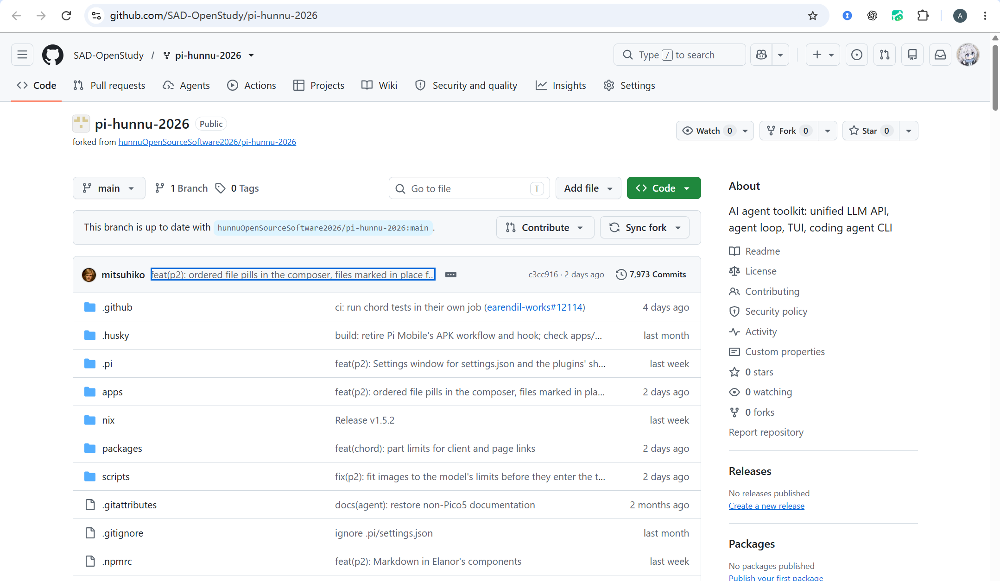
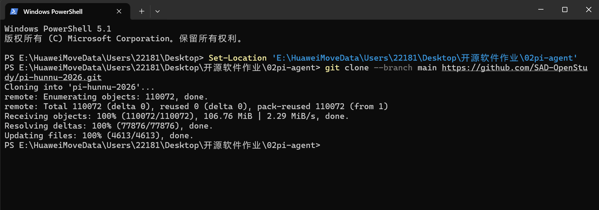
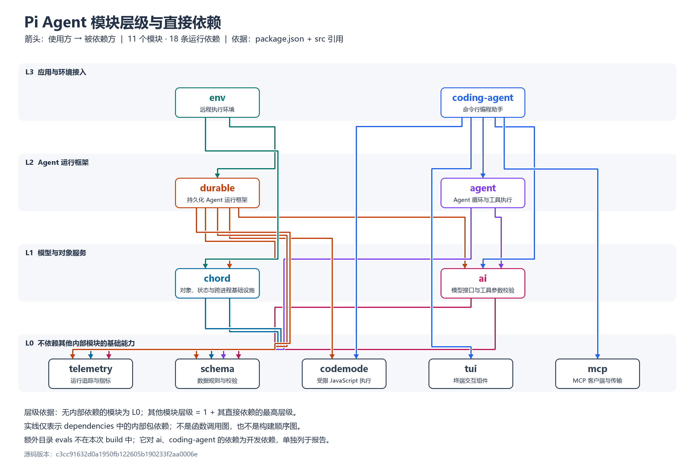

# 实践课2：组织建仓与源码分析

- 姓名：王栋新（`wangdongxin`）
- GitHub：`yun12345R`；小组组织：`SAD-OpenStudy`
- 小组仓库：https://github.com/SAD-OpenStudy/pi-hunnu-2026
- 实际 Clone 地址：https://github.com/SAD-OpenStudy/pi-hunnu-2026.git
- 分支：`main`；提交编号：`c3cc91632d0a1950fb122605b190233f2aa0006e`
- 本人重点分析模块：`telemetry`、`schema`

## 一、源码获取

### 1. 小组组织仓库

组长将老师的课程仓库 Fork 到了 `SAD-OpenStudy` 组织。我打开小组仓库，确认了仓库名称和 Fork 来源。



### 2. 下载并检查本地源码

我在 PowerShell 中执行下面的命令，把小组仓库下载到桌面的本次作业文件夹中。

```powershell
# 进入本次作业目录
Set-Location 'E:\HuaweiMoveData\Users\22181\Desktop\开源软件作业\02pi-agent'
# 下载小组仓库的 main 分支
git clone --branch main https://github.com/SAD-OpenStudy/pi-hunnu-2026.git
# 进入源码目录
Set-Location .\pi-hunnu-2026
```

下载结束后，接收对象、解析差异和更新文件均显示完成。



接着，我检查了本地目录、远端地址、分支和提交编号。

```powershell
# 查看本地目录
Get-Location
# 查看远端地址
git remote -v
# 查看当前分支
git branch --show-current
# 查看完整提交编号
git rev-parse HEAD
# 检查文件是否有改动
git status --short
```

检查结果：`origin` 指向 `SAD-OpenStudy/pi-hunnu-2026`，分支为 `main`，提交编号与报告开头一致。`git status --short` 没有输出，说明工作区没有改动。


### 3. 查看源码目录


本版本另有 `evals` 目录，但不在根构建列表中，本次分析作业要求的 11 个模块。

## 二、构建顺序与模块分析

### 1. 构建顺序

我读取了根目录 `package.json` 的 `scripts.build`，并按 `&&` 拆开查看。

```powershell
# 读取根目录配置
$config = Get-Content .\package.json -Raw | ConvertFrom-Json
# 显示各步构建命令
$config.scripts.build -split '&&'
```


构建顺序为：

```text
telemetry → schema → chord → tui → codemode → mcp
→ ai → durable → env → agent → coding-agent
```

根脚本依次进入各模块目录，再执行模块自己的 `npm run build`。`&&` 表示前一步成功后才继续下一步。[根配置](https://github.com/SAD-OpenStudy/pi-hunnu-2026/blob/c3cc91632d0a1950fb122605b190233f2aa0006e/package.json)

### 2. 模块分析表

下表按各模块的 README、`package.json`、编译配置和源码整理。“内部依赖”指配置中直接声明的其他 Pi 模块，构建产物按配置说明。

| 子文件夹 | 主要功能 | build 执行什么、生成什么 | 直接内部依赖 | 依据 |
|---|---|---|---|---|
| `telemetry` | 提供运行追踪和指标统计接口，用来记录操作耗时、事件及结果，也提供内存记录实现。 | `tsc -p tsconfig.build.json`，将 `src` 编译到 `dist`。 | 无 | [配置](https://github.com/SAD-OpenStudy/pi-hunnu-2026/blob/c3cc91632d0a1950fb122605b190233f2aa0006e/packages/telemetry/package.json)、[源码](https://github.com/SAD-OpenStudy/pi-hunnu-2026/blob/c3cc91632d0a1950fb122605b190233f2aa0006e/packages/telemetry/src/index.ts) |
| `schema` | 定义并校验数据规则，检查字段类型、必填项和取值限制，并给出错误字段的位置。 | `tsc -p tsconfig.build.json`，将 `src` 编译到 `dist`。 | 无 | [配置](https://github.com/SAD-OpenStudy/pi-hunnu-2026/blob/c3cc91632d0a1950fb122605b190233f2aa0006e/packages/schema/package.json)、[源码](https://github.com/SAD-OpenStudy/pi-hunnu-2026/blob/c3cc91632d0a1950fb122605b190233f2aa0006e/packages/schema/src/index.ts) |
| `chord` | 管理带状态和方法的对象，支持跨进程引用、事务文档、数据存储和插件热重载。 | `tsc -p tsconfig.build.json`，将 `src` 编译到 `dist`。 | `schema`、`telemetry` | [配置](https://github.com/SAD-OpenStudy/pi-hunnu-2026/blob/c3cc91632d0a1950fb122605b190233f2aa0006e/packages/chord/package.json)、[源码](https://github.com/SAD-OpenStudy/pi-hunnu-2026/blob/c3cc91632d0a1950fb122605b190233f2aa0006e/packages/chord/src/data/validator.ts) |
| `tui` | 提供终端界面和输入、编辑器、Markdown 等组件，通过差量渲染减少界面闪烁。 | `tsc -p tsconfig.build.json`，将 `src` 编译到 `dist`。 | 无 | [配置](https://github.com/SAD-OpenStudy/pi-hunnu-2026/blob/c3cc91632d0a1950fb122605b190233f2aa0006e/packages/tui/package.json)、[源码](https://github.com/SAD-OpenStudy/pi-hunnu-2026/blob/c3cc91632d0a1950fb122605b190233f2aa0006e/packages/tui/src/tui.ts) |
| `codemode` | 在 QuickJS/WebAssembly 环境中执行模型生成的 JavaScript，通过注入的工具提供受限能力。 | `tsc -p tsconfig.build.json`，将 `src` 编译到 `dist`。 | 无 | [配置](https://github.com/SAD-OpenStudy/pi-hunnu-2026/blob/c3cc91632d0a1950fb122605b190233f2aa0006e/packages/codemode/package.json)、[源码](https://github.com/SAD-OpenStudy/pi-hunnu-2026/blob/c3cc91632d0a1950fb122605b190233f2aa0006e/packages/codemode/src/runtime/host.ts) |
| `mcp` | 连接 MCP 工具服务器，处理初始化、工具请求、超时和取消，支持 stdio、HTTP 等传输。 | `tsc -p tsconfig.build.json`，将 `src` 编译到 `dist`。 | 无 | [配置](https://github.com/SAD-OpenStudy/pi-hunnu-2026/blob/c3cc91632d0a1950fb122605b190233f2aa0006e/packages/mcp/package.json)、[源码](https://github.com/SAD-OpenStudy/pi-hunnu-2026/blob/c3cc91632d0a1950fb122605b190233f2aa0006e/packages/mcp/src/client.ts) |
| `ai` | 统一不同模型服务的调用、消息及流式事件，管理模型目录、鉴权、用量和工具参数校验。 | 先生成模型目录，再检查数据、执行 tsc，并复制模型 JSON 到 `dist/providers/data`。 | `schema`、`telemetry` | [配置](https://github.com/SAD-OpenStudy/pi-hunnu-2026/blob/c3cc91632d0a1950fb122605b190233f2aa0006e/packages/ai/package.json)、[源码](https://github.com/SAD-OpenStudy/pi-hunnu-2026/blob/c3cc91632d0a1950fb122605b190233f2aa0006e/packages/ai/src/utils/validation.ts) |
| `durable` | 保存会话、模型轮次、工具调用和应用状态，为 Agent 提供中断后恢复的能力。 | `tsc -p tsconfig.build.json`，将 `src` 编译到 `dist`。 | `chord`、`ai`、`codemode`、`schema`、`telemetry` | [配置](https://github.com/SAD-OpenStudy/pi-hunnu-2026/blob/c3cc91632d0a1950fb122605b190233f2aa0006e/packages/durable/package.json)、[源码](https://github.com/SAD-OpenStudy/pi-hunnu-2026/blob/c3cc91632d0a1950fb122605b190233f2aa0006e/packages/durable/src/harness/provider.ts) |
| `env` | 为 durable 提供远程执行环境，通过 SSH 和远端守护程序处理文件与命令操作。 | `tsc -p tsconfig.build.json`，将 `src` 编译到 `dist`。Rust 守护程序由独立的 `build:daemon` 构建。 | `chord`、`durable` | [配置](https://github.com/SAD-OpenStudy/pi-hunnu-2026/blob/c3cc91632d0a1950fb122605b190233f2aa0006e/packages/env/package.json)、[源码](https://github.com/SAD-OpenStudy/pi-hunnu-2026/blob/c3cc91632d0a1950fb122605b190233f2aa0006e/packages/env/src/remote-env.ts) |
| `agent` | 维护消息和 Agent 状态，组织模型轮次、工具执行及事件流，把工具结果反馈给模型。 | `tsc -p tsconfig.build.json`，将 `src` 编译到 `dist`。 | `ai`、`schema` | [配置](https://github.com/SAD-OpenStudy/pi-hunnu-2026/blob/c3cc91632d0a1950fb122605b190233f2aa0006e/packages/agent/package.json)、[源码](https://github.com/SAD-OpenStudy/pi-hunnu-2026/blob/c3cc91632d0a1950fb122605b190233f2aa0006e/packages/agent/src/agent-loop.ts) |
| `coding-agent` | 组合 Agent、模型、终端界面和工具能力，提供编程助手的 CLI、SDK、扩展和会话入口。 | 先执行 `build:unbundled` 编译和复制资源，再用 esbuild 打包；CLI 为 `dist/bundle/cli.js`。 | `agent`、`ai`、`codemode`、`mcp`、`tui` | [配置](https://github.com/SAD-OpenStudy/pi-hunnu-2026/blob/c3cc91632d0a1950fb122605b190233f2aa0006e/packages/coding-agent/package.json)、[源码](https://github.com/SAD-OpenStudy/pi-hunnu-2026/blob/c3cc91632d0a1950fb122605b190233f2aa0006e/packages/coding-agent/src/core/sdk.ts) |

使用 tsc 的模块通过各自的 `tsconfig.build.json` 指定输入和输出，并继承根编译配置。除 `.js` 外，还会生成 `.d.ts` 类型声明和映射文件。[根编译配置](https://github.com/SAD-OpenStudy/pi-hunnu-2026/blob/c3cc91632d0a1950fb122605b190233f2aa0006e/tsconfig.base.json)

### 3. 重点模块的理解

我重点分析了 `telemetry` 和 `schema`。这两个模块的构建方式相同，但负责的工作不同。

`telemetry` 可以理解为程序的“运行记录接口”，记录操作耗时、事件和结果。它的开发依赖只有 `@types/node`、`vitest`，没有其他内部模块依赖。

`schema` 则像“数据规则检查员”。例如规定 `name` 必须是字符串、`age` 必须是非负整数，它就能检查数据是否符合要求，并指出错误字段。源码入口导出了 `obj`、`str`、`int` 等构建器，以及 `compile`、`Validator` 等校验接口。它也没有其他内部模块依赖。

两者都把 `src` 中的源码编译到 `dist`。这也让我分清了：`src` 放开发时修改的源码，`dist` 放编译生成的文件。

## 三、模块层级与依赖关系图



[draw.io 可编辑图源](diagrams/module-dependencies.drawio) · [Mermaid 图源](diagrams/module-dependencies.mmd)

我按内部依赖关系把模块分为四层：无内部依赖的放在 L0，其余模块放在它所依赖模块的上层。图中箭头统一为“使用方 → 被依赖方”，共 18 条直接依赖。

| 层级 | 模块 | 划分依据 |
|---|---|---|
| L0 基础能力 | telemetry、schema、tui、codemode、mcp | 没有其他内部模块依赖 |
| L1 模型与对象服务 | ai、chord | 使用 L0 的 schema、telemetry |
| L2 Agent 运行框架 | agent、durable | 使用 ai、chord 等下层模块 |
| L3 应用与环境接入 | coding-agent、env | 分别组合 Agent 能力和远程执行能力 |

图中实线对应 `dependencies` 中的直接内部依赖。chord 的 `esbuild`、`react`、`ws` 属于外部可选 peer 依赖，所以没有列为内部节点。

## 四、问题回答

### 1. 根目录与子模块中的 npm run build 分别读取什么配置、执行什么工作？

我的理解是，同名的 build 命令在不同目录下，读取的配置也不同。在根目录执行时，它读取根 `package.json` 的 `scripts.build`，安排各模块的构建顺序；在 `packages/schema` 下执行时，它读取 schema 自己的 `package.json`，运行 `tsc -p tsconfig.build.json`。

tsc 再根据编译配置把 `src` 编译到 `dist`。有些模块还有额外步骤：ai 会生成和复制模型目录数据；coding-agent 会复制资源并打包；env 的普通 build 只编译 TypeScript，Rust 守护程序要另外执行 `build:daemon`。

### 2. 构建顺序和模块依赖有什么关系？相邻构建的模块是否一定互相依赖？

如果一个模块编译时需要另一个模块的产物，就应先构建被依赖的模块。例如 durable 的编译配置指向 chord、ai 的 `dist` 类型声明，所以它们要先构建。[durable 编译配置](https://github.com/SAD-OpenStudy/pi-hunnu-2026/blob/c3cc91632d0a1950fb122605b190233f2aa0006e/packages/durable/tsconfig.build.json)

但相邻构建不一定表示互相依赖。根脚本中 schema 紧跟 telemetry，可 schema 并不依赖 telemetry；mcp 紧跟 codemode，也没有依赖 codemode。因此，构建顺序是一种执行安排，依赖关系还要看包配置和源码，不能把顺序中的所有相邻模块都连成依赖线。

### 3. 选择一条涉及至少三个模块的依赖路径，说明这些模块如何分工。

我选择的是工具参数校验相关的路径：

```text
coding-agent → agent → ai → schema
```

| 模块 | 在这条路径中的分工 | 源码依据 |
|---|---|---|
| coding-agent | 创建 Agent，把会话、工具和模型流函数交给它 | [sdk.ts 中创建 Agent](https://github.com/SAD-OpenStudy/pi-hunnu-2026/blob/c3cc91632d0a1950fb122605b190233f2aa0006e/packages/coding-agent/src/core/sdk.ts#L403) |
| agent | 组织工具调用，在执行前调用 ai 提供的参数校验函数 | [agent-loop.ts](https://github.com/SAD-OpenStudy/pi-hunnu-2026/blob/c3cc91632d0a1950fb122605b190233f2aa0006e/packages/agent/src/agent-loop.ts#L736) |
| ai | 使用 schema 编译校验规则，检查工具参数并整理错误 | [validation.ts](https://github.com/SAD-OpenStudy/pi-hunnu-2026/blob/c3cc91632d0a1950fb122605b190233f2aa0006e/packages/ai/src/utils/validation.ts#L15) |
| schema | 提供规则构建器和校验器，检查字段是否符合要求 | [src/index.ts](https://github.com/SAD-OpenStudy/pi-hunnu-2026/blob/c3cc91632d0a1950fb122605b190233f2aa0006e/packages/schema/src/index.ts) |

通过这条路径，我理解到上层模块主要负责组织功能，下层模块提供通用能力。这样可以复用已有的参数校验逻辑。
