# 实践课2：组织建仓与源码分析

- 姓名：王栋新；姓名拼音：`wangdongxin`
- GitHub：`yun12345R`；小组组织：`SAD-OpenStudy`
- 小组代码仓库：https://github.com/SAD-OpenStudy/pi-hunnu-2026
- 实际 Clone 地址：https://github.com/SAD-OpenStudy/pi-hunnu-2026.git
- 源码分支：`main`
- 完整提交编号：`c3cc91632d0a1950fb122605b190233f2aa0006e`
- 本人重点分析：`telemetry`、`schema`。这两个模块已在前面的终端操作中逐步查看了说明、构建脚本、编译配置和依赖。

## 一、实验目标、范围和材料

本次任务是确认小组组织仓库与本地源码的对应关系，阅读构建涉及的 11 个模块，分析模块职责、构建产物与直接依赖，并绘制模块层级图。报告依据固定提交的说明文档、配置和源码整理。模块功能使用中文归纳，并为结论列出可定位的依据。

本报告的源码下载和前两模块截图来自实际操作；后续模块阅读、交叉核验、制图和报告整理使用 AI 辅助，结论均回到本次源码及配置核对。未把 README 中的性能、测试通过数量当成本次实测结果。这里记录的是静态源码分析；尚未安装项目依赖，也未完成编译或模型会话。这些属于实践课3的后续内容。

教师要求：[小组组织建仓与 Pi Agent 源码阅读](https://github.com/hunnuOpenSourceSoftware2026/assignments/blob/main/practice/02-Pi-Agent-fork.md)。

## 二、组织仓库与源码获取

### 2.1 小组组织仓库

组长已把教师课程仓库 Fork 到 `SAD-OpenStudy` 组织。下图显示组织名称、仓库名称、教师仓库来源及 `main` 分支，仓库放在小组组织下。


Fork 是在 GitHub 上建立小组自己的仓库副本；Clone 是把这个仓库下载到成员自己的电脑。每位成员都需要完成自己的 Clone。

### 2.2 本人下载源码

实际保存位置为：

```text
E:\HuaweiMoveData\Users\22181\Desktop\开源软件作业\02pi-agent\pi-hunnu-2026
```

在 PowerShell 中执行：

```powershell
# 进入桌面本次作业目录
Set-Location 'E:\HuaweiMoveData\Users\22181\Desktop\开源软件作业\02pi-agent'

# 从小组组织仓库下载 main 分支
git clone --branch main https://github.com/SAD-OpenStudy/pi-hunnu-2026.git

# 进入下载的源码目录
Set-Location .\pi-hunnu-2026
```

终端显示接收对象、解析差异和更新文件均完成 100%，随后返回命令提示符。


### 2.3 本地仓库版本核验（S1）

```powershell
# 查看本地目录
Get-Location
# 查看下载与推送的仓库地址
git remote -v
# 查看当前分支
git branch --show-current
# 查看完整提交编号
git rev-parse HEAD
# 查看是否有未提交改动
git status --short
```

核验结果：`origin` 指向小组组织仓库，当前分支为 `main`，完整提交为 `c3cc91632d0a1950fb122605b190233f2aa0006e`；`git status --short` 无输出。接手完成报告时再次核验，源码仍保持该提交且无改动。

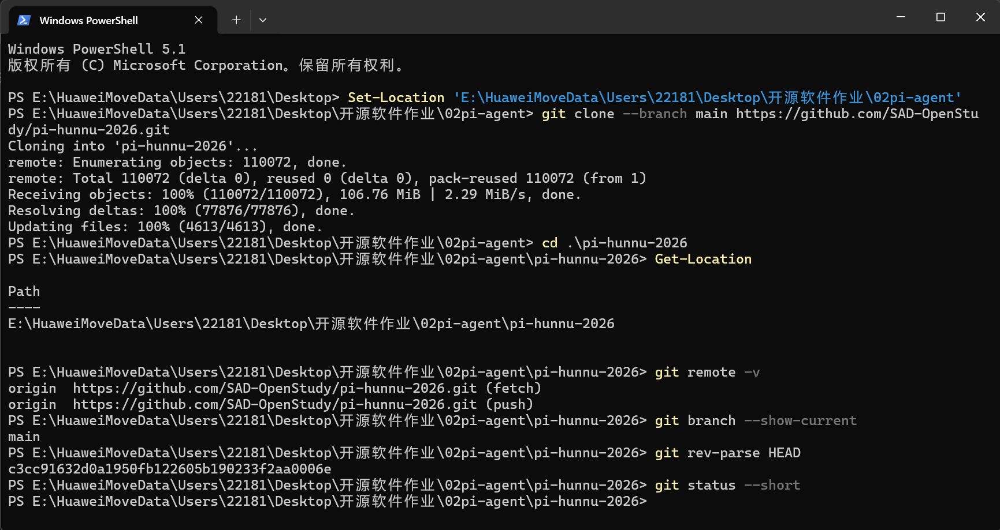

### 2.4 源码目录及版本差异

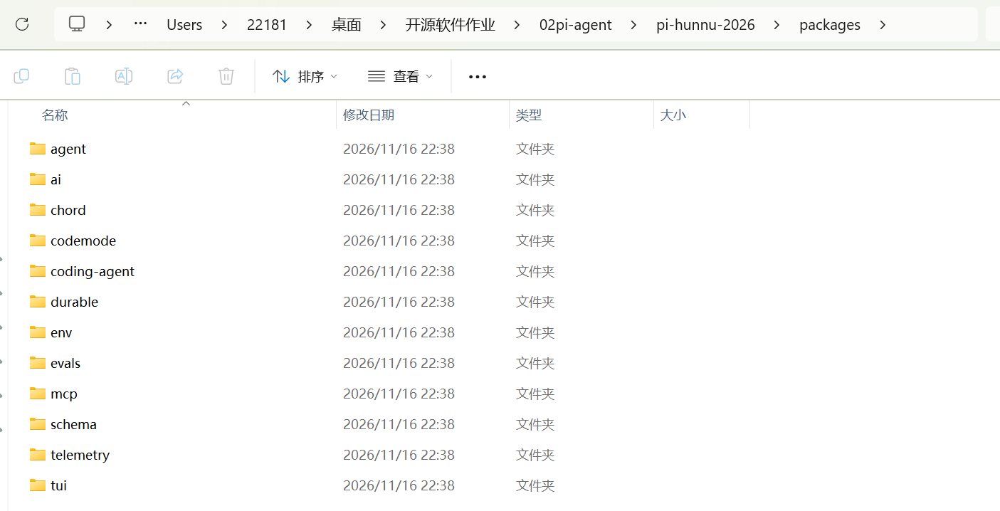

本地 `packages/` 实际有 12 个目录：老师列出的 11 个模块，以及额外的 `evals`。根配置的 `scripts.build` 只列出了老师要求的 11 个模块。`evals` 是私有评估工作区，没有 `build` 脚本，不应为了凑数把它写进根构建顺序。它在 `devDependencies` 中使用 `ai` 和 `coding-agent`，下文单独标记这两条开发依赖。依据：[evals 配置](https://github.com/SAD-OpenStudy/pi-hunnu-2026/blob/c3cc91632d0a1950fb122605b190233f2aa0006e/packages/evals/package.json)。

源码沿用本人指定的桌面作业目录，路径包含中文，与老师“尽量在全英文路径下下载”的建议不同。实际 Clone、Git 核验和文本阅读均已成功；本次未编译，因此不据此推断后续全部工具都支持此路径。若实践课3出现明确的路径兼容问题，再单独处理。

## 三、构建顺序与模块分析

### 3.1 根构建脚本

读取根目录 `package.json` 的 `scripts.build`，按 `&&` 拆分后得到：

```text
telemetry → schema → chord → tui → codemode → mcp
→ ai → durable → env → agent → coding-agent
```

```powershell
# 在源码根目录读取配置
$config = Get-Content .\package.json -Raw | ConvertFrom-Json
# 仅显示 build 中的各步，不执行构建
$config.scripts.build -split '&&'
```

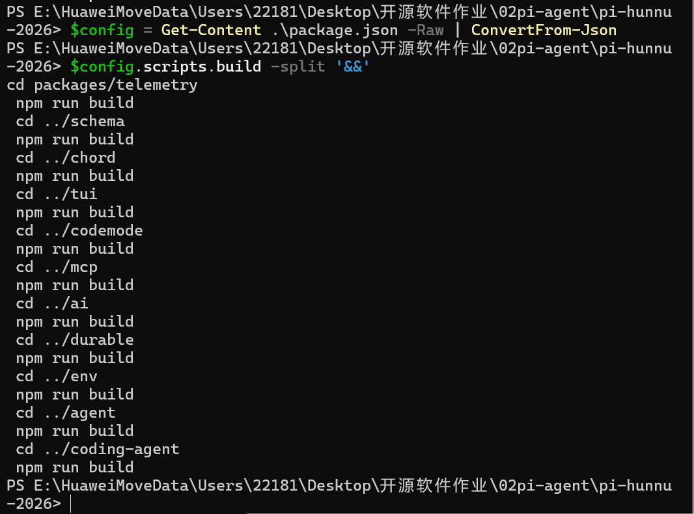

`cd packages/telemetry && npm run build` 表示进入 telemetry 后执行它的构建命令，成功后再继续。`&&` 保证前一步成功才进入下一步。上述箭头只表示顺序，不表示模块依赖。依据：[根 scripts.build](https://github.com/SAD-OpenStudy/pi-hunnu-2026/blob/c3cc91632d0a1950fb122605b190233f2aa0006e/package.json)。

### 3.2 模块分析表

“直接内部依赖”按各模块 `package.json` 的 `dependencies` 判定，并用 `src` 中的引用交叉核验。源码中的纯类型导入与运行时导入有所区别，但都不改变该包在配置中声明的依赖类别。产物栏描述配置规定的预期结果，不作为实际构建成功证明。

| 子文件夹 | 代码主要实现什么功能 | 本模块 build 执行什么、生成什么 | 直接依赖哪些内部模块 | 依据文件或代码位置 |
|---|---|---|---|---|
| `telemetry` | 提供运行追踪、计数器和耗时分布等指标接口，以及空操作和内存记录实现。其他模块用同一套接口记录运行情况，不绑定某一家监控后端。 | `tsc -p tsconfig.build.json`；把 `src` 编译到 `dist`，预期生成 `.js`、`.d.ts` 及映射文件。 | 无内部模块直接依赖 | [说明](https://github.com/SAD-OpenStudy/pi-hunnu-2026/blob/c3cc91632d0a1950fb122605b190233f2aa0006e/packages/telemetry/README.md)、[配置](https://github.com/SAD-OpenStudy/pi-hunnu-2026/blob/c3cc91632d0a1950fb122605b190233f2aa0006e/packages/telemetry/package.json)、[编译配置](https://github.com/SAD-OpenStudy/pi-hunnu-2026/blob/c3cc91632d0a1950fb122605b190233f2aa0006e/packages/telemetry/tsconfig.build.json)、[源码](https://github.com/SAD-OpenStudy/pi-hunnu-2026/blob/c3cc91632d0a1950fb122605b190233f2aa0006e/packages/telemetry/src/index.ts) |
| `schema` | 提供 JSON Schema 构建器和数据校验器，检查字段类型、必填项及取值限制，失败时给出字段路径；校验实现不使用 eval。 | `tsc -p tsconfig.build.json`；把 `src` 编译到 `dist`，预期生成 `.js`、`.d.ts` 及映射文件。 | 无内部模块直接依赖 | [说明](https://github.com/SAD-OpenStudy/pi-hunnu-2026/blob/c3cc91632d0a1950fb122605b190233f2aa0006e/packages/schema/README.md)、[配置](https://github.com/SAD-OpenStudy/pi-hunnu-2026/blob/c3cc91632d0a1950fb122605b190233f2aa0006e/packages/schema/package.json)、[编译配置](https://github.com/SAD-OpenStudy/pi-hunnu-2026/blob/c3cc91632d0a1950fb122605b190233f2aa0006e/packages/schema/tsconfig.build.json)、[源码](https://github.com/SAD-OpenStudy/pi-hunnu-2026/blob/c3cc91632d0a1950fb122605b190233f2aa0006e/packages/schema/src/index.ts) |
| `chord` | 把带状态和方法的对象组织成应用，支持本地与跨进程引用、事务文档、插件热重载和数据存储，给上层提供对象与状态基础设施。 | `tsc -p tsconfig.build.json`；把 `src` 编译到 `dist`，预期生成 `.js`、`.d.ts` 及映射文件。 | `schema`、`telemetry` | [说明](https://github.com/SAD-OpenStudy/pi-hunnu-2026/blob/c3cc91632d0a1950fb122605b190233f2aa0006e/packages/chord/README.md)、[配置](https://github.com/SAD-OpenStudy/pi-hunnu-2026/blob/c3cc91632d0a1950fb122605b190233f2aa0006e/packages/chord/package.json)、[编译配置](https://github.com/SAD-OpenStudy/pi-hunnu-2026/blob/c3cc91632d0a1950fb122605b190233f2aa0006e/packages/chord/tsconfig.build.json)、[源码](https://github.com/SAD-OpenStudy/pi-hunnu-2026/blob/c3cc91632d0a1950fb122605b190233f2aa0006e/packages/chord/src/data/validator.ts) |
| `tui` | 提供终端交互界面、差量渲染和同步输出；包含输入框、编辑器、Markdown、列表等组件，负责把交互内容显示在终端。 | `tsc -p tsconfig.build.json`；把 `src` 编译到 `dist`，预期生成 `.js`、`.d.ts` 及映射文件。 | 无内部模块直接依赖 | [说明](https://github.com/SAD-OpenStudy/pi-hunnu-2026/blob/c3cc91632d0a1950fb122605b190233f2aa0006e/packages/tui/README.md)、[配置](https://github.com/SAD-OpenStudy/pi-hunnu-2026/blob/c3cc91632d0a1950fb122605b190233f2aa0006e/packages/tui/package.json)、[编译配置](https://github.com/SAD-OpenStudy/pi-hunnu-2026/blob/c3cc91632d0a1950fb122605b190233f2aa0006e/packages/tui/tsconfig.build.json)、[源码](https://github.com/SAD-OpenStudy/pi-hunnu-2026/blob/c3cc91632d0a1950fb122605b190233f2aa0006e/packages/tui/src/tui.ts) |
| `codemode` | 在 QuickJS/WebAssembly 执行环境中运行模型编写的 JavaScript，通过注入的工具提供受限能力；把脚本输出和返回值交回宿主。 | `tsc -p tsconfig.build.json`；把 `src` 编译到 `dist`，预期生成 `.js`、`.d.ts` 及映射文件。 | 无内部模块直接依赖 | [说明](https://github.com/SAD-OpenStudy/pi-hunnu-2026/blob/c3cc91632d0a1950fb122605b190233f2aa0006e/packages/codemode/README.md)、[配置](https://github.com/SAD-OpenStudy/pi-hunnu-2026/blob/c3cc91632d0a1950fb122605b190233f2aa0006e/packages/codemode/package.json)、[编译配置](https://github.com/SAD-OpenStudy/pi-hunnu-2026/blob/c3cc91632d0a1950fb122605b190233f2aa0006e/packages/codemode/tsconfig.build.json)、[源码](https://github.com/SAD-OpenStudy/pi-hunnu-2026/blob/c3cc91632d0a1950fb122605b190233f2aa0006e/packages/codemode/src/runtime/host.ts) |
| `mcp` | 独立的 MCP 客户端，处理初始化、请求匹配、超时和取消；通过 stdio、Streamable HTTP 等传输连接工具服务器。 | `tsc -p tsconfig.build.json`；把 `src` 编译到 `dist`，预期生成 `.js`、`.d.ts` 及映射文件。 | 无内部模块直接依赖 | [说明](https://github.com/SAD-OpenStudy/pi-hunnu-2026/blob/c3cc91632d0a1950fb122605b190233f2aa0006e/packages/mcp/README.md)、[配置](https://github.com/SAD-OpenStudy/pi-hunnu-2026/blob/c3cc91632d0a1950fb122605b190233f2aa0006e/packages/mcp/package.json)、[编译配置](https://github.com/SAD-OpenStudy/pi-hunnu-2026/blob/c3cc91632d0a1950fb122605b190233f2aa0006e/packages/mcp/tsconfig.build.json)、[源码](https://github.com/SAD-OpenStudy/pi-hunnu-2026/blob/c3cc91632d0a1950fb122605b190233f2aa0006e/packages/mcp/src/client.ts) |
| `ai` | 统一不同模型服务商的接口、消息和流式事件，提供模型目录、鉴权解析、用量费用统计，以及工具参数校验。 | 先 `generate-models` 生成模型目录，再执行 `build:offline`：检查数据、TypeScript 编译，并把模型 JSON 复制到 `dist/providers/data`。 | `schema`、`telemetry` | [说明](https://github.com/SAD-OpenStudy/pi-hunnu-2026/blob/c3cc91632d0a1950fb122605b190233f2aa0006e/packages/ai/README.md)、[配置](https://github.com/SAD-OpenStudy/pi-hunnu-2026/blob/c3cc91632d0a1950fb122605b190233f2aa0006e/packages/ai/package.json)、[编译配置](https://github.com/SAD-OpenStudy/pi-hunnu-2026/blob/c3cc91632d0a1950fb122605b190233f2aa0006e/packages/ai/tsconfig.build.json)、[源码](https://github.com/SAD-OpenStudy/pi-hunnu-2026/blob/c3cc91632d0a1950fb122605b190233f2aa0006e/packages/ai/src/utils/validation.ts) |
| `durable` | 持久化 Agent 运行框架，把会话、模型轮次、工具调用和应用状态保存到存储，并支持中断后恢复；使用 chord 管理文档状态、ai 接入模型。 | `tsc -p tsconfig.build.json`；把 `src` 编译到 `dist`，预期生成 `.js`、`.d.ts` 及映射文件。 | `chord`、`ai`、`codemode`、`schema`、`telemetry` | [说明](https://github.com/SAD-OpenStudy/pi-hunnu-2026/blob/c3cc91632d0a1950fb122605b190233f2aa0006e/packages/durable/README.md)、[配置](https://github.com/SAD-OpenStudy/pi-hunnu-2026/blob/c3cc91632d0a1950fb122605b190233f2aa0006e/packages/durable/package.json)、[编译配置](https://github.com/SAD-OpenStudy/pi-hunnu-2026/blob/c3cc91632d0a1950fb122605b190233f2aa0006e/packages/durable/tsconfig.build.json)、[源码](https://github.com/SAD-OpenStudy/pi-hunnu-2026/blob/c3cc91632d0a1950fb122605b190233f2aa0006e/packages/durable/src/harness/provider.ts) |
| `env` | 为 durable 提供远程执行环境，通过连接及 SSH 部署或调用远端守护程序，把文件操作和命令放到另一台机器执行。 | `tsc -p tsconfig.build.json`；把 `src` 编译到 `dist`，预期生成 `.js`、`.d.ts` 及映射文件。 Rust 守护程序另用 `build:daemon`，不由本次根 build 自动执行。 | `chord`、`durable` | [说明](https://github.com/SAD-OpenStudy/pi-hunnu-2026/blob/c3cc91632d0a1950fb122605b190233f2aa0006e/packages/env/README.md)、[配置](https://github.com/SAD-OpenStudy/pi-hunnu-2026/blob/c3cc91632d0a1950fb122605b190233f2aa0006e/packages/env/package.json)、[编译配置](https://github.com/SAD-OpenStudy/pi-hunnu-2026/blob/c3cc91632d0a1950fb122605b190233f2aa0006e/packages/env/tsconfig.build.json)、[源码](https://github.com/SAD-OpenStudy/pi-hunnu-2026/blob/c3cc91632d0a1950fb122605b190233f2aa0006e/packages/env/src/remote-env.ts) |
| `agent` | 维护消息和 Agent 状态，组织模型轮次、工具调用和事件流；把工具执行结果反馈到后续模型上下文。模型流函数可以由宿主注入。 | `tsc -p tsconfig.build.json`；把 `src` 编译到 `dist`，预期生成 `.js`、`.d.ts` 及映射文件。 | `ai`、`schema` | [说明](https://github.com/SAD-OpenStudy/pi-hunnu-2026/blob/c3cc91632d0a1950fb122605b190233f2aa0006e/packages/agent/README.md)、[配置](https://github.com/SAD-OpenStudy/pi-hunnu-2026/blob/c3cc91632d0a1950fb122605b190233f2aa0006e/packages/agent/package.json)、[编译配置](https://github.com/SAD-OpenStudy/pi-hunnu-2026/blob/c3cc91632d0a1950fb122605b190233f2aa0006e/packages/agent/tsconfig.build.json)、[源码](https://github.com/SAD-OpenStudy/pi-hunnu-2026/blob/c3cc91632d0a1950fb122605b190233f2aa0006e/packages/agent/src/agent-loop.ts) |
| `coding-agent` | 用户直接使用的编程助手 CLI/SDK，组合 Agent、模型接口、终端界面、MCP 和代码执行能力，并提供会话、扩展、技能及 RPC 等入口。 | 先 `build:unbundled` 编译 TypeScript、设置入口可执行标记并复制资源，再由 esbuild 打包到 `dist/bundle`；CLI 入口为 `dist/bundle/cli.js`。 | `agent`、`ai`、`codemode`、`mcp`、`tui` | [说明](https://github.com/SAD-OpenStudy/pi-hunnu-2026/blob/c3cc91632d0a1950fb122605b190233f2aa0006e/packages/coding-agent/README.md)、[配置](https://github.com/SAD-OpenStudy/pi-hunnu-2026/blob/c3cc91632d0a1950fb122605b190233f2aa0006e/packages/coding-agent/package.json)、[编译配置](https://github.com/SAD-OpenStudy/pi-hunnu-2026/blob/c3cc91632d0a1950fb122605b190233f2aa0006e/packages/coding-agent/tsconfig.build.json)、[源码](https://github.com/SAD-OpenStudy/pi-hunnu-2026/blob/c3cc91632d0a1950fb122605b190233f2aa0006e/packages/coding-agent/src/core/sdk.ts) |

普通模块继承根 `tsconfig.base.json`。其中 `declaration`、`declarationMap`、`sourceMap` 为真，所以除 JavaScript 外还预期生成类型声明及映射文件。依据：[基编译配置](https://github.com/SAD-OpenStudy/pi-hunnu-2026/blob/c3cc91632d0a1950fb122605b190233f2aa0006e/tsconfig.base.json)。

### 3.3 本人重点分析：telemetry 与 schema

**telemetry。** 我把它理解为其他模块共享的“运行记录接口”。它描述一项操作的跨度、事件、状态和指标，也提供内存记录及不记录数据的空操作实现。它没有自带监控数据导出器，也不依赖某一家监控服务。`src/index.ts` 中的上下文、跨度和指标类型与 README 相对应。

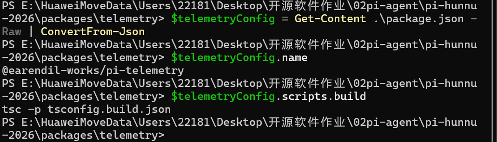
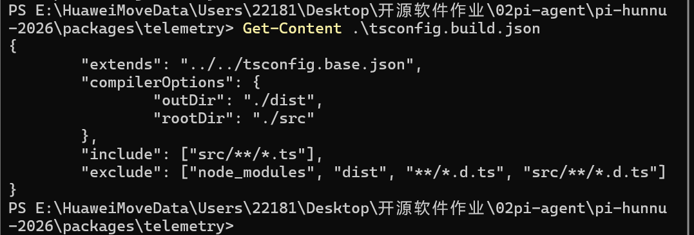
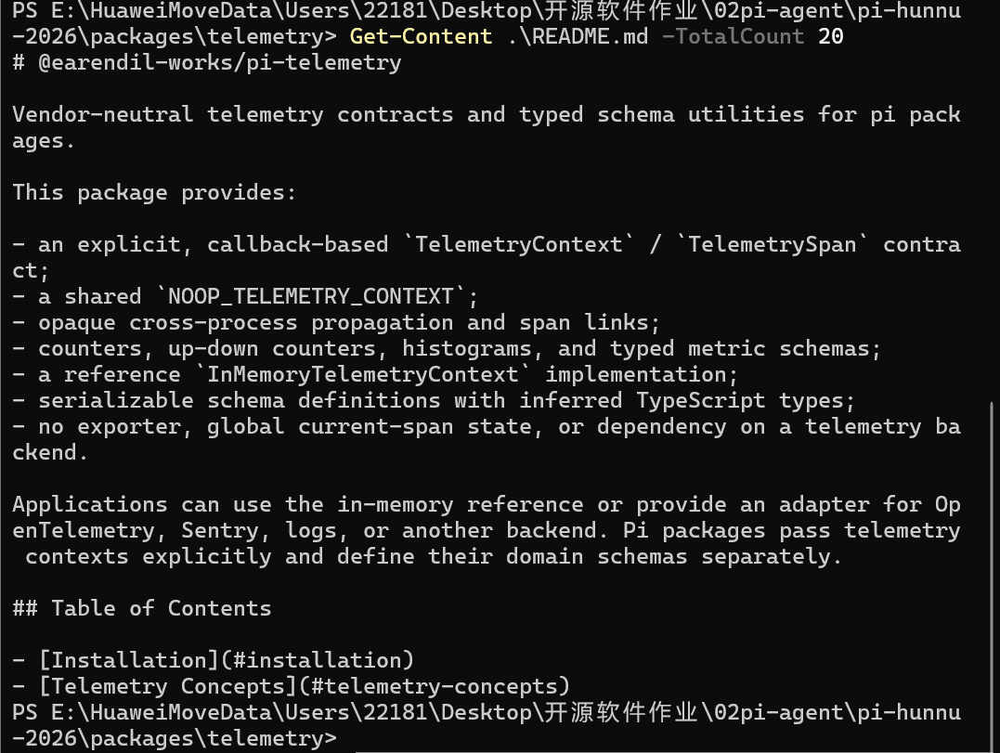
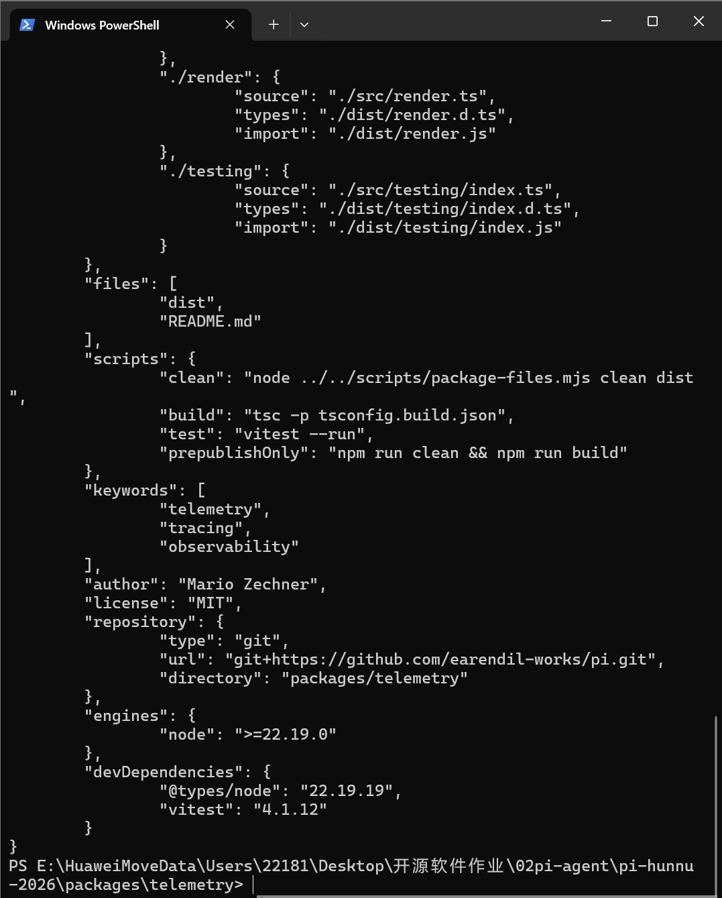

其运行依赖中没有其他内部包；开发依赖 `@types/node` 用于 Node.js 类型支持，`vitest` 用于测试。外部开发工具不应画成内部模块依赖。

**schema。** 我把它理解为“数据规则检查员”：先用构建器定义字段和限制，再由校验器检查数据，错误时定位到字段。`src/index.ts` 导出 `obj`、`str`、`int` 等构建器及 `compile`、`Validator`，可与 README 的用法对应起来。它也没有内部模块直接依赖。`ajv`、`typebox`、`zod`、`vitest` 等在这里列于开发依赖；例如基准测试候选实现会导入这些校验库，不代表 schema 的运行实现依赖这些库。

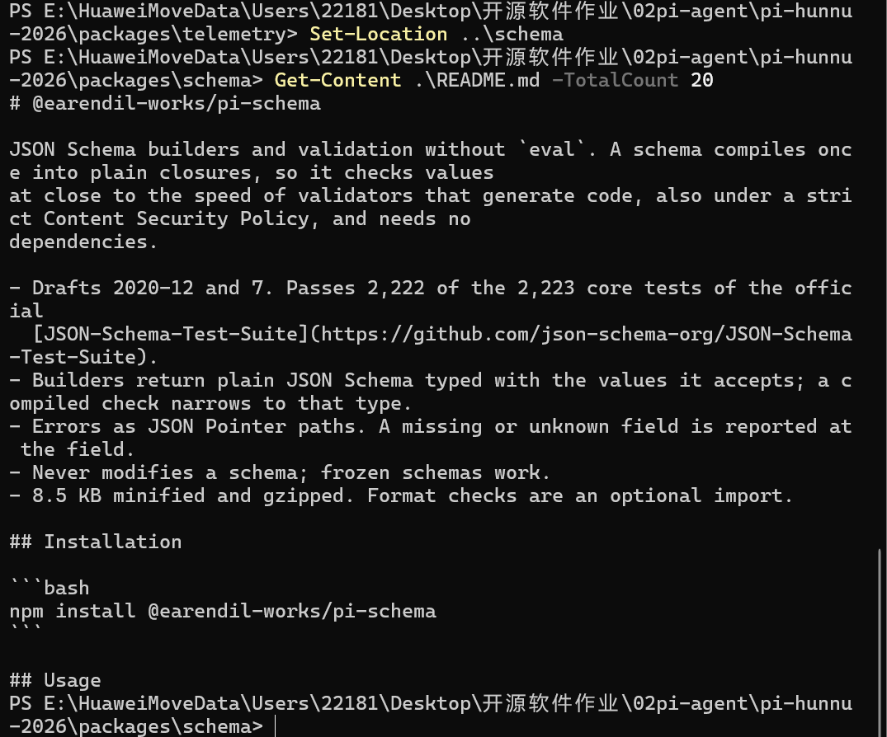
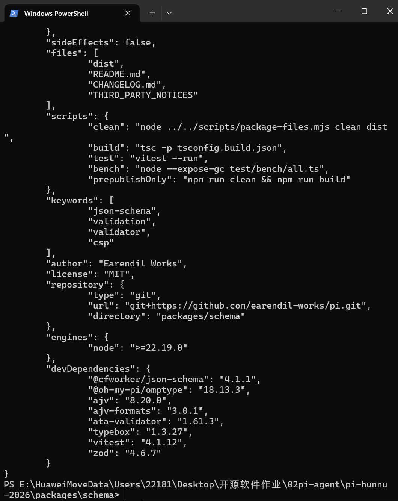
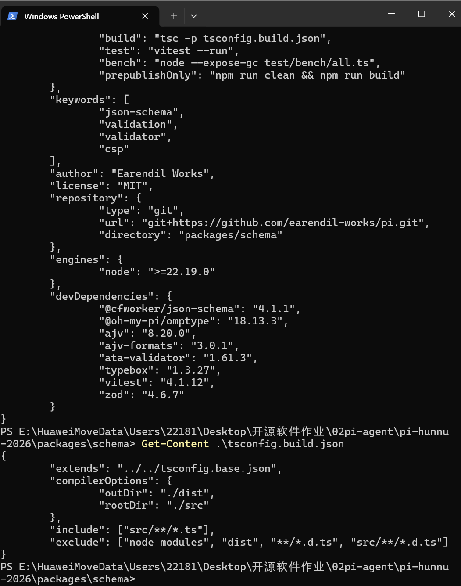

这两个模块都用 TypeScript 编译器把 `src` 编译到 `dist`，但功能不同：一个观察程序运行，一个检查数据。schema 在根脚本中紧跟 telemetry，却并不依赖 telemetry，正好说明“构建顺序相邻”与“存在依赖”是两回事。

### 3.4 特殊构建流程与配置细节

1. **ai：生成数据后再编译。** `build` 是 `npm run generate-models && npm run build:offline`。`generate-models` 调用 `node catalog/generate.ts --strict`；`build:offline` 先检查模型数据，再编译，并复制模型 JSON 到 `dist/providers/data`。目录、能力和价格等数据不是大模型权重；本次只读脚本，没有运行生成器。依据：[ai 脚本](https://github.com/SAD-OpenStudy/pi-hunnu-2026/blob/c3cc91632d0a1950fb122605b190233f2aa0006e/packages/ai/package.json)、[模型目录说明](https://github.com/SAD-OpenStudy/pi-hunnu-2026/blob/c3cc91632d0a1950fb122605b190233f2aa0006e/packages/ai/catalog/README.md)。
2. **coding-agent：编译、复制资源，再打包。** `build:unbundled` 包含 TypeScript 编译、入口文件处理和资源复制；随后 `scripts/build-coding-agent-bundle.mjs` 用 esbuild 生成 CLI、SDK、RPC 及相关分块。`bin.pi` 指向 `dist/bundle/cli.js`。`build:binary` 是另外的脚本，根 build 不会执行它。依据：[CLI 配置](https://github.com/SAD-OpenStudy/pi-hunnu-2026/blob/c3cc91632d0a1950fb122605b190233f2aa0006e/packages/coding-agent/package.json)、[打包脚本](https://github.com/SAD-OpenStudy/pi-hunnu-2026/blob/c3cc91632d0a1950fb122605b190233f2aa0006e/scripts/build-coding-agent-bundle.mjs)。
3. **env：TypeScript 与 Rust 分开。** `build` 只执行 tsc；`build:daemon` 才调用 `cargo build --manifest-path daemon/Cargo.toml --locked`。不能把根构建通过等同于 Rust 守护程序已编译。依据：[env 脚本](https://github.com/SAD-OpenStudy/pi-hunnu-2026/blob/c3cc91632d0a1950fb122605b190233f2aa0006e/packages/env/package.json)、[Rust 配置](https://github.com/SAD-OpenStudy/pi-hunnu-2026/blob/c3cc91632d0a1950fb122605b190233f2aa0006e/packages/env/daemon/Cargo.toml)。
4. **显式的编译路径依赖。** `durable` 的编译配置把 chord、ai 的入口指向对应 `dist` 声明文件；`env` 指向 chord、durable 的声明；agent 和 coding-agent 也引用下层的 `dist` 类型。这提供了“先构建被依赖包”的具体配置依据，不能只凭模块名称推断。依据见分析表中的编译配置链接。
5. **外部可选 peer 依赖。** chord 的 `esbuild`、`react`、`ws` 在 `peerDependenciesMeta` 中标为可选，分别供相应入口使用。它们是外部包，不是本次 11 个内部节点。所有 11 个模块中没有额外的内部开发、peer 或 optional 依赖；额外 evals 的内部开发依赖另列。

## 四、模块层级与依赖关系图


- [可编辑 draw.io 图源](diagrams/module-dependencies.drawio)：用 diagrams.net 打开，可逐个编辑节点和箭头。
- [Mermaid 图源](diagrams/module-dependencies.mmd)：也可编辑和重新渲染。
- [SVG 矢量图](diagrams/module-dependencies.svg)：可放大阅读；报告中嵌入 PNG 便于显示。
- [额外 evals 开发依赖图源](diagrams/evals-development-dependencies.mmd)。

### 4.1 层级划分依据

按本次 18 条内部直接运行依赖进行分层：没有内部依赖的模块为 L0；其他模块的层级等于 1 加上它直接依赖模块中的最高层级。这样每一条箭头均从高层指向低层。它是便于解释当前依赖结构的分析分层，不表示源码作者宣布了唯一的架构划分。

| 层级 | 模块 | 分层理由 |
|---|---|---|
| L0 基础能力 | telemetry、schema、tui、codemode、mcp | 都没有直接内部运行依赖，各自提供可独立使用的能力 |
| L1 模型与对象服务 | ai、chord | 都使用 L0 的 schema、telemetry |
| L2 Agent 运行框架 | agent、durable | agent 使用 ai、schema；durable 使用 ai、chord 等下层能力 |
| L3 应用与环境接入 | coding-agent、env | coding-agent 集成 agent 及界面、工具能力；env 适配 durable 与 chord |

“基础”在这里指依赖层级，不等于程序启动顺序。coding-agent 与 env 是同层的不同用途模块，本版本中没有 coding-agent → env 这条直接依赖。

### 4.2 直接依赖逐条证据

图中的 18 条实线对应下表的 `dependencies` 行；额外两条 `devDependencies` 只属于 evals，不混入主图。源码证据可能是类型或值的引用，表中分类以依赖声明为准，不把图当作每次运行必经的函数调用链。

| 使用方 → 被依赖方 | 声明类别 | 配置依据 | 源码引用依据 |
|---|---|---|---|
| `chord → schema` | `dependencies` | [依赖声明](https://github.com/SAD-OpenStudy/pi-hunnu-2026/blob/c3cc91632d0a1950fb122605b190233f2aa0006e/packages/chord/package.json#L173) | [packages/chord/src/data/validator.ts](https://github.com/SAD-OpenStudy/pi-hunnu-2026/blob/c3cc91632d0a1950fb122605b190233f2aa0006e/packages/chord/src/data/validator.ts#L3) |
| `chord → telemetry` | `dependencies` | [依赖声明](https://github.com/SAD-OpenStudy/pi-hunnu-2026/blob/c3cc91632d0a1950fb122605b190233f2aa0006e/packages/chord/package.json#L174) | [packages/chord/src/telemetry-sqlite/node.ts](https://github.com/SAD-OpenStudy/pi-hunnu-2026/blob/c3cc91632d0a1950fb122605b190233f2aa0006e/packages/chord/src/telemetry-sqlite/node.ts#L4) |
| `ai → schema` | `dependencies` | [依赖声明](https://github.com/SAD-OpenStudy/pi-hunnu-2026/blob/c3cc91632d0a1950fb122605b190233f2aa0006e/packages/ai/package.json#L84) | [packages/ai/src/utils/string-enum.ts](https://github.com/SAD-OpenStudy/pi-hunnu-2026/blob/c3cc91632d0a1950fb122605b190233f2aa0006e/packages/ai/src/utils/string-enum.ts#L1) |
| `ai → telemetry` | `dependencies` | [依赖声明](https://github.com/SAD-OpenStudy/pi-hunnu-2026/blob/c3cc91632d0a1950fb122605b190233f2aa0006e/packages/ai/package.json#L85) | [packages/ai/src/telemetry.ts](https://github.com/SAD-OpenStudy/pi-hunnu-2026/blob/c3cc91632d0a1950fb122605b190233f2aa0006e/packages/ai/src/telemetry.ts#L10) |
| `durable → chord` | `dependencies` | [依赖声明](https://github.com/SAD-OpenStudy/pi-hunnu-2026/blob/c3cc91632d0a1950fb122605b190233f2aa0006e/packages/durable/package.json#L167) | [packages/durable/src/storage/sqlite/database.ts](https://github.com/SAD-OpenStudy/pi-hunnu-2026/blob/c3cc91632d0a1950fb122605b190233f2aa0006e/packages/durable/src/storage/sqlite/database.ts#L1) |
| `durable → ai` | `dependencies` | [依赖声明](https://github.com/SAD-OpenStudy/pi-hunnu-2026/blob/c3cc91632d0a1950fb122605b190233f2aa0006e/packages/durable/package.json#L168) | [packages/durable/src/harness/provider.ts](https://github.com/SAD-OpenStudy/pi-hunnu-2026/blob/c3cc91632d0a1950fb122605b190233f2aa0006e/packages/durable/src/harness/provider.ts#L2) |
| `durable → codemode` | `dependencies` | [依赖声明](https://github.com/SAD-OpenStudy/pi-hunnu-2026/blob/c3cc91632d0a1950fb122605b190233f2aa0006e/packages/durable/package.json#L169) | [packages/durable/src/tool-search/tool-search.ts](https://github.com/SAD-OpenStudy/pi-hunnu-2026/blob/c3cc91632d0a1950fb122605b190233f2aa0006e/packages/durable/src/tool-search/tool-search.ts#L6) |
| `durable → schema` | `dependencies` | [依赖声明](https://github.com/SAD-OpenStudy/pi-hunnu-2026/blob/c3cc91632d0a1950fb122605b190233f2aa0006e/packages/durable/package.json#L170) | [packages/durable/src/tools/write.ts](https://github.com/SAD-OpenStudy/pi-hunnu-2026/blob/c3cc91632d0a1950fb122605b190233f2aa0006e/packages/durable/src/tools/write.ts#L1) |
| `durable → telemetry` | `dependencies` | [依赖声明](https://github.com/SAD-OpenStudy/pi-hunnu-2026/blob/c3cc91632d0a1950fb122605b190233f2aa0006e/packages/durable/package.json#L171) | [packages/durable/src/harness/telemetry.ts](https://github.com/SAD-OpenStudy/pi-hunnu-2026/blob/c3cc91632d0a1950fb122605b190233f2aa0006e/packages/durable/src/harness/telemetry.ts#L1) |
| `env → chord` | `dependencies` | [依赖声明](https://github.com/SAD-OpenStudy/pi-hunnu-2026/blob/c3cc91632d0a1950fb122605b190233f2aa0006e/packages/env/package.json#L48) | [packages/env/src/list-files.ts](https://github.com/SAD-OpenStudy/pi-hunnu-2026/blob/c3cc91632d0a1950fb122605b190233f2aa0006e/packages/env/src/list-files.ts#L1) |
| `env → durable` | `dependencies` | [依赖声明](https://github.com/SAD-OpenStudy/pi-hunnu-2026/blob/c3cc91632d0a1950fb122605b190233f2aa0006e/packages/env/package.json#L49) | [packages/env/src/errors.ts](https://github.com/SAD-OpenStudy/pi-hunnu-2026/blob/c3cc91632d0a1950fb122605b190233f2aa0006e/packages/env/src/errors.ts#L1) |
| `agent → ai` | `dependencies` | [依赖声明](https://github.com/SAD-OpenStudy/pi-hunnu-2026/blob/c3cc91632d0a1950fb122605b190233f2aa0006e/packages/agent/package.json#L26) | [packages/agent/src/proxy.ts](https://github.com/SAD-OpenStudy/pi-hunnu-2026/blob/c3cc91632d0a1950fb122605b190233f2aa0006e/packages/agent/src/proxy.ts#L17) |
| `agent → schema` | `dependencies` | [依赖声明](https://github.com/SAD-OpenStudy/pi-hunnu-2026/blob/c3cc91632d0a1950fb122605b190233f2aa0006e/packages/agent/package.json#L27) | [packages/agent/src/types.ts](https://github.com/SAD-OpenStudy/pi-hunnu-2026/blob/c3cc91632d0a1950fb122605b190233f2aa0006e/packages/agent/src/types.ts#L17) |
| `coding-agent → agent` | `dependencies` | [依赖声明](https://github.com/SAD-OpenStudy/pi-hunnu-2026/blob/c3cc91632d0a1950fb122605b190233f2aa0006e/packages/coding-agent/package.json#L44) | [packages/coding-agent/src/core/defaults.ts](https://github.com/SAD-OpenStudy/pi-hunnu-2026/blob/c3cc91632d0a1950fb122605b190233f2aa0006e/packages/coding-agent/src/core/defaults.ts#L1) |
| `coding-agent → ai` | `dependencies` | [依赖声明](https://github.com/SAD-OpenStudy/pi-hunnu-2026/blob/c3cc91632d0a1950fb122605b190233f2aa0006e/packages/coding-agent/package.json#L45) | [packages/coding-agent/src/utils/pi-user-agent.ts](https://github.com/SAD-OpenStudy/pi-hunnu-2026/blob/c3cc91632d0a1950fb122605b190233f2aa0006e/packages/coding-agent/src/utils/pi-user-agent.ts#L1) |
| `coding-agent → codemode` | `dependencies` | [依赖声明](https://github.com/SAD-OpenStudy/pi-hunnu-2026/blob/c3cc91632d0a1950fb122605b190233f2aa0006e/packages/coding-agent/package.json#L46) | [packages/coding-agent/src/extensions/tool-search/tool.ts](https://github.com/SAD-OpenStudy/pi-hunnu-2026/blob/c3cc91632d0a1950fb122605b190233f2aa0006e/packages/coding-agent/src/extensions/tool-search/tool.ts#L11) |
| `coding-agent → mcp` | `dependencies` | [依赖声明](https://github.com/SAD-OpenStudy/pi-hunnu-2026/blob/c3cc91632d0a1950fb122605b190233f2aa0006e/packages/coding-agent/package.json#L47) | [packages/coding-agent/src/core/radius-mcp.ts](https://github.com/SAD-OpenStudy/pi-hunnu-2026/blob/c3cc91632d0a1950fb122605b190233f2aa0006e/packages/coding-agent/src/core/radius-mcp.ts#L2) |
| `coding-agent → tui` | `dependencies` | [依赖声明](https://github.com/SAD-OpenStudy/pi-hunnu-2026/blob/c3cc91632d0a1950fb122605b190233f2aa0006e/packages/coding-agent/package.json#L48) | [packages/coding-agent/src/utils/web-url.ts](https://github.com/SAD-OpenStudy/pi-hunnu-2026/blob/c3cc91632d0a1950fb122605b190233f2aa0006e/packages/coding-agent/src/utils/web-url.ts#L1) |
| `evals → ai` | `devDependencies` | [依赖声明](https://github.com/SAD-OpenStudy/pi-hunnu-2026/blob/c3cc91632d0a1950fb122605b190233f2aa0006e/packages/evals/package.json#L15) | [packages/evals/src/harness.ts](https://github.com/SAD-OpenStudy/pi-hunnu-2026/blob/c3cc91632d0a1950fb122605b190233f2aa0006e/packages/evals/src/harness.ts#L8) |
| `evals → coding-agent` | `devDependencies` | [依赖声明](https://github.com/SAD-OpenStudy/pi-hunnu-2026/blob/c3cc91632d0a1950fb122605b190233f2aa0006e/packages/evals/package.json#L16) | [packages/evals/src/harness.ts](https://github.com/SAD-OpenStudy/pi-hunnu-2026/blob/c3cc91632d0a1950fb122605b190233f2aa0006e/packages/evals/src/harness.ts#L20) |

特别说明：mcp 文档给出了与 env、agent、ai 的组合示例，但 mcp 的配置和实现没有把这些包列为直接依赖。示例中的“可以一起用”不能直接画成包依赖箭头。对所有模块的 src 引用扫描，未发现声明以外的其他内部包引用。

## 五、三个问题的回答

### 5.1 根目录与子模块中的 npm run build 分别读取什么配置、执行什么工作？

在项目根目录执行 `npm run build`，npm 读取根 `package.json` 的 `scripts.build`，按照其中写明的顺序进入各子目录构建。在 `packages/schema` 中执行同名命令，则读取 schema 自己的 `package.json`，执行 `tsc -p tsconfig.build.json`。命令名称相同，具体工作由所在包的配置决定。

tsc 再读取该模块的编译配置以及它继承的根配置，确定输入、输出、类型声明等选项。普通模块主要从 `src` 生成 `dist`；ai 和 coding-agent 还会做数据生成、复制资源或打包。npm 本身不会替所有项目规定同一种编译方式。

例如，根脚本中的 `cd packages/telemetry && npm run build` 是“先选中模块，再执行模块的脚本”。PowerShell 中也可用 `npm.cmd` 调用 npm 的 Windows 命令入口；这不改变读取哪个配置文件的规则。

### 5.2 构建顺序和模块依赖有什么关系？相邻构建的模块是否一定互相依赖？

如果使用方的编译需要被依赖方已经生成的文件，就要先构建被依赖方。本版本的 18 条内部运行依赖，都满足“被依赖方在根构建列表中更早”的关系。例如 durable 的编译配置显式引用 chord、ai 的 dist 声明，说明这个顺序有实际依据。

但根脚本给出的是包含全部模块的一个串行顺序；多个互不依赖的模块也必须被排成先后。schema 紧跟 telemetry，两者没有直接依赖；mcp 紧跟 codemode，也没有依赖 codemode。因此不能把整个构建列表顺次连线当成依赖图。根脚本还会构建 coding-agent 没有直接使用的 durable、env，不能据此认定所有模块都位于 CLI 的调用链上。

### 5.3 选择一条至少三个模块的依赖路径，说明模块如何分工。

选择四个模块的路径：

```text
coding-agent → agent → ai → schema
```

1. **coding-agent 组织会话。** `src/core/sdk.ts` 导入并创建 `Agent`，把会话消息、工具、上下文转换和模型流函数交给 Agent。[创建 Agent](https://github.com/SAD-OpenStudy/pi-hunnu-2026/blob/c3cc91632d0a1950fb122605b190233f2aa0006e/packages/coding-agent/src/core/sdk.ts#L403)
2. **agent 组织工具调用流程。** Agent 循环处理模型产生的工具调用，在执行工具前使用从 ai 导入的 `validateToolArguments` 检查参数。[导入校验函数](https://github.com/SAD-OpenStudy/pi-hunnu-2026/blob/c3cc91632d0a1950fb122605b190233f2aa0006e/packages/agent/src/agent-loop.ts#L19)、[调用参数校验](https://github.com/SAD-OpenStudy/pi-hunnu-2026/blob/c3cc91632d0a1950fb122605b190233f2aa0006e/packages/agent/src/agent-loop.ts#L736)
3. **ai 提供工具参数校验。** `src/utils/validation.ts` 缓存规则对应的校验器，调用 schema 的 `compile` 构建校验器，再解析参数；不合格时整理字段错误返回。[ai 参数校验实现](https://github.com/SAD-OpenStudy/pi-hunnu-2026/blob/c3cc91632d0a1950fb122605b190233f2aa0006e/packages/ai/src/utils/validation.ts#L15)
4. **schema 执行数据规则。** `compile`、构建器和 Validator 负责按 JSON Schema 判定字段是否合格。这样上层不用重复实现校验规则。[schema 导出入口](https://github.com/SAD-OpenStudy/pi-hunnu-2026/blob/c3cc91632d0a1950fb122605b190233f2aa0006e/packages/schema/src/index.ts)

这条路径用来说明真实的直接依赖及工具参数校验分工，不声称每次纯文本对话都必经这些函数。另一个细节是本版本 agent 的模型流函数可以由宿主注入；不能把它描述为固定在内部直接选择某个服务商。

## 六、遇到的问题与处理

阅读构建命令时曾在 telemetry 目录尝试执行 `npm run build`，但命令立即报“找不到 npm”，没有进入编译。检查发现 Node.js 已安装在 `D:\Node.js`，原系统搜索路径里的对应项有拼写错误。补入正确的当前用户 PATH 后，原终端再临时补入该目录，`node --version` 输出 `v24.18.0`。

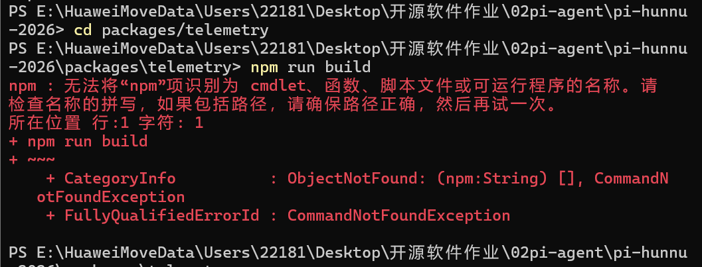

随后 PowerShell 阻止加载 `npm.ps1`。改用安装目录附带的 `npm.cmd --version`，输出 `11.16.0`，没有更改脚本执行策略。

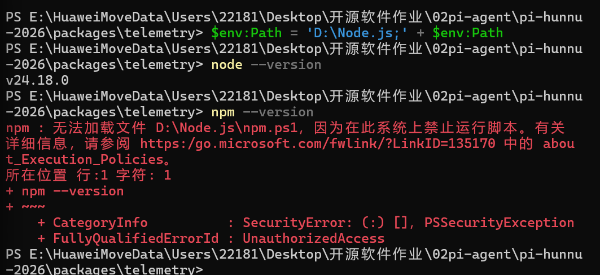
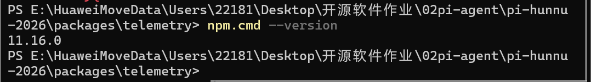

```powershell
# 让原先已打开的终端找到 Node.js
$env:Path = 'D:\Node.js;' + $env:Path
# 检查版本；使用 Windows 命令入口避免加载 npm.ps1
node --version
npm.cmd --version
```

此问题处理只证明工具可以被当前终端找到，不证明依赖已安装或项目已构建。本次继续进行源码分析。

## 七、可复核材料与实验认识

- [源码核验与阅读命令](evidence/commands.ps1)：只读命令，可按模块重复核验。
- [模块配置与内部依赖记录](evidence/module-audit.json)：记录固定提交、构建脚本、依赖类别和引用位置。
- [差异与核验说明](evidence/verification.md)：区分实际操作、静态结论和未运行的内容。

通过两个重点模块的对比，可以把“功能”“构建”和“依赖”分开理解：功能来自说明和实现，构建来自 scripts 与编译配置，依赖则要检查声明及源码引用。读到构建命令，不等于执行过构建；源码目录存在，也不等于所有功能都已运行成功。
