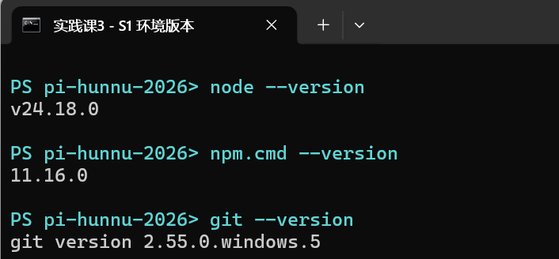
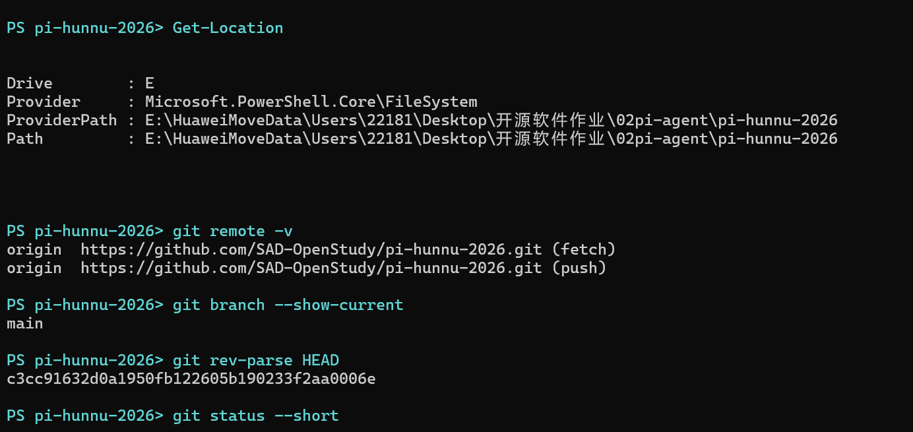
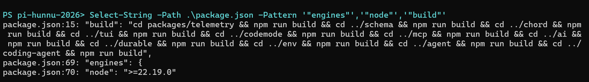
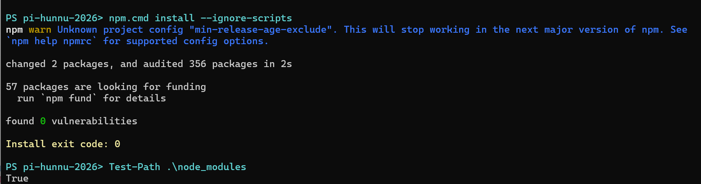
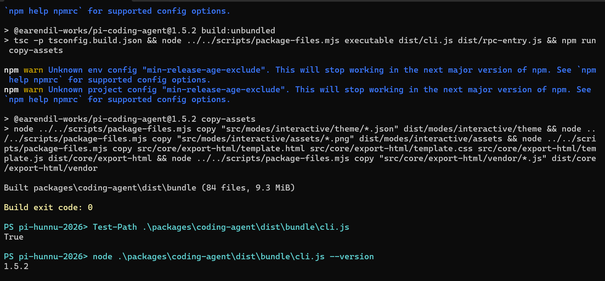
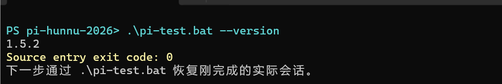
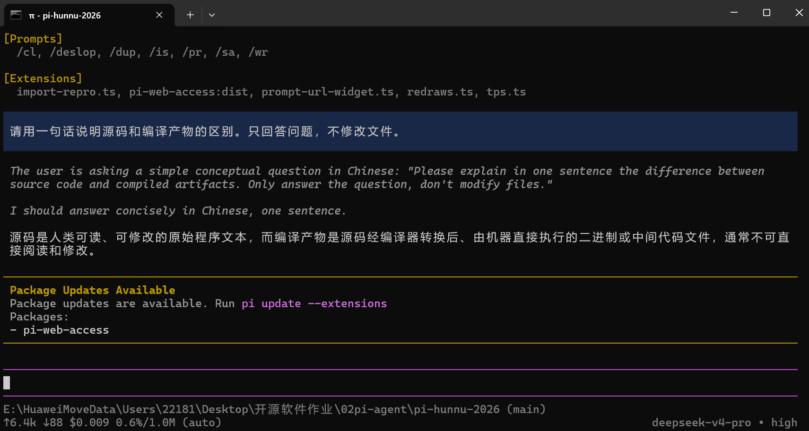

# 实践课3：Pi Agent源码安装与编译

- 姓名：王栋新（wangdongxin）
- GitHub：yun12345R
- 小组仓库：https://github.com/SAD-OpenStudy/pi-hunnu-2026
- 分支：main
- 提交编号：c3cc91632d0a1950fb122605b190233f2aa0006e

## 一、环境准备与源码确认

这次继续使用实践课2下载的小组源码。我检查了 Node.js、npm 和 Git，版本分别为 v24.18.0、11.16.0、2.55.0.windows.5。



我通过 git remote -v、git branch --show-current 和 git rev-parse HEAD 核对来源、分支和版本。origin 指向小组仓库，分支为 main，工作区没有未提交改动。



## 二、查看配置

根 package.json 的 engines.node 要求 Node.js >=22.19.0，我使用的版本满足要求。scripts.build 定义根构建命令，依次进入各个子包执行它们自己的 build；具体的编译工作由各包的 package.json 决定，&& 表示前一步成功才继续。



## 三、安装依赖

我在仓库根目录执行：

```powershell
# 安装项目依赖，跳过安装阶段的自动脚本
npm.cmd install --ignore-scripts
```

该命令根据 package.json 和锁文件安装依赖，并关联工作区内的子包。依赖保存在本项目的 node_modules 中；没有 -g，所以不会替换全局的 pi。--ignore-scripts 跳过安装阶段的 postinstall、prepare 等脚本，后面仍可主动执行 build。

安装命令正常结束，退出码为 0。本次审计检查了 356 个包，显示 found 0 vulnerabilities。



## 四、本地编译与产物验证

我在根目录执行 npm.cmd run build，构建结束后检查 CLI 文件，并通过它的实际路径读取版本。

```powershell
# 执行根构建脚本
npm.cmd run build
# 检查编译后的 CLI 文件
Test-Path .\packages\coding-agent\dist\bundle\cli.js
# 运行编译产物查看版本
node .\packages\coding-agent\dist\bundle\cli.js --version
```

完整构建退出码为 0，入口文件检查返回 True，运行后输出 1.5.2。首次构建会生成模型目录、能力等配置数据，这不是下载大模型权重。



## 五、运行本地源码并完成对话

我用 .\pi-test.bat --version 验证源码入口，输出 1.5.2；随后通过 .\pi-test.bat 启动本地源码版，复用之前已配置的 DeepSeek 账号。



提示词是：“请用一句话说明源码和编译产物的区别。只回答问题，不修改文件。”本地源码版收到实际模型回复。



这次通过仓库内的 .\pi-test.bat 启动，它实际运行 src/cli.ts，因此能确认入口来自本地源码。直接输入 pi 可能启动全局安装版。源码入口方便开发时检查修改；dist/bundle/cli.js 是构建后的入口，适合验证编译结果。修改代码应修改 src，再重新构建。

## 六、遇到的问题与处理

安装和构建时出现 min-release-age-exclude 配置提示。我先检查完整输出和退出码，确认命令成功；没有直接执行 npm audit fix --force，也没有因此改动课程依赖。相关提示和安装结果见第三部分截图。

另外，原来 Pi 的配置保存在 D:\Pi-Agent\agent，默认目录没有登录配置。我在当前终端指定 PI_CODING_AGENT_DIR 后复用已有账号，源码版对话成功，不需要再次填写 API Key。
