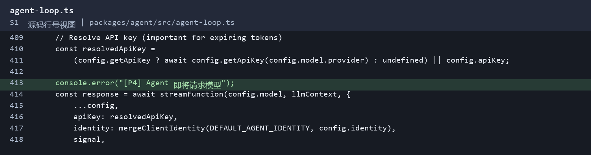
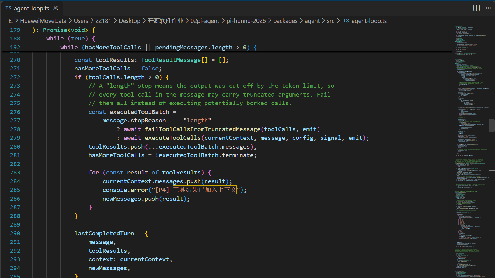
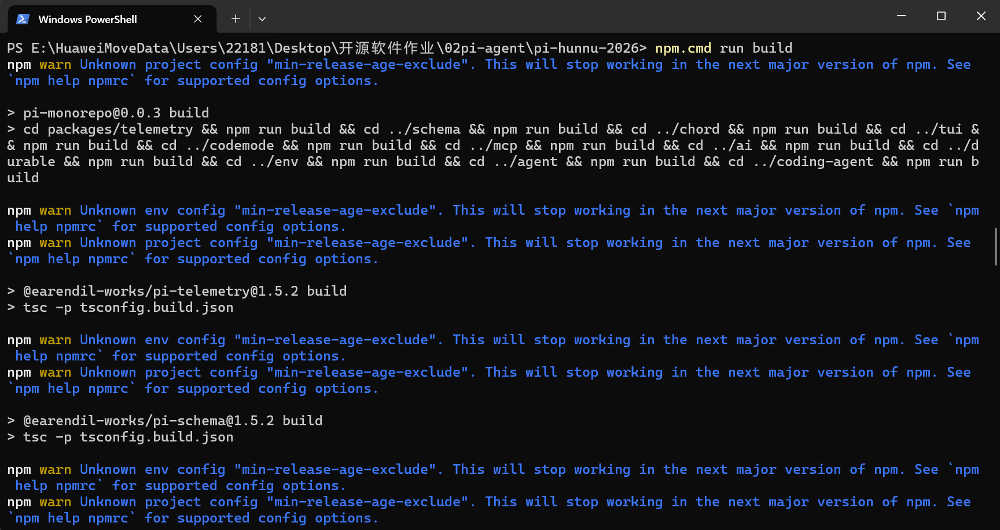
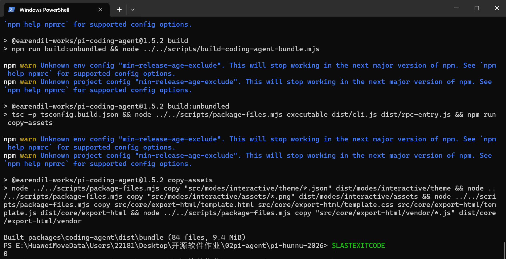
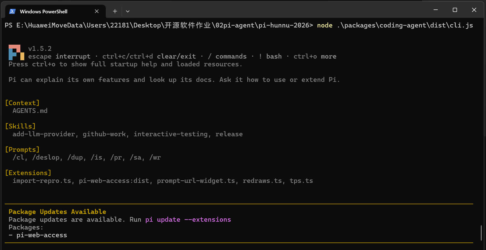
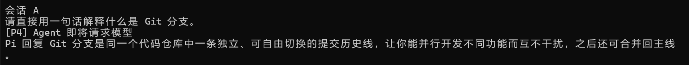
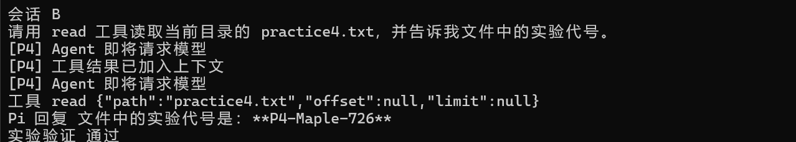
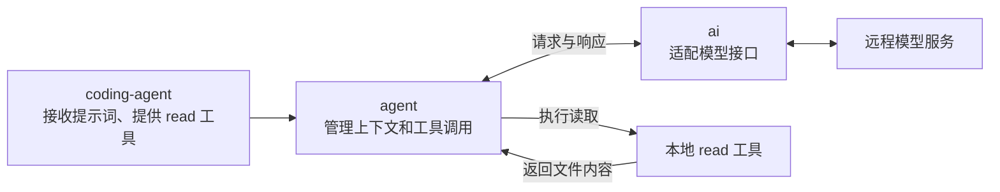

# 实践课 4：Pi Agent 的模型调用与运行流程

## 一、源码修改

在 `packages/agent/src/agent-loop.ts` 增加两行日志。第 285 行位于 `for` 循环内，紧接着工具结果写入上下文的语句。

```diff
 for (const result of toolResults) {
     currentContext.messages.push(result);
+    console.error("[P4] 工具结果已加入上下文");
     newMessages.push(result);
 }
```

第 413 行紧挨着 `await streamFunction(...)`，记录 Agent 准备请求模型的时刻。

```diff
+console.error("[P4] Agent 即将请求模型");
 const response = await streamFunction(config.model, llmContext, {
```

S1、S2 为 VS Code 原始截图，分别显示第 413 行和第 285 行的日志。





## 二、重新编译并启动

在小组 Pi 仓库根目录运行 `npm.cmd run build`。实际输出如下。

```text
pi-hunnu-2026 | npm.cmd run build
…
Built packages\coding-agent\dist\bundle (84 files, 9.4 MiB)
构建进程退出码 0
```





S3a、S3b 分别记录构建开始和结束。构建完成后，在同一 PowerShell 窗口执行 `$LASTEXITCODE`，返回 `0`。

编译后的 `packages/coding-agent/dist/cli.js` 输出版本号 `1.5.2`。下图是运行 `node .\packages\coding-agent\dist\cli.js` 后的 PowerShell 原始截图，显示启动命令和 Pi 交互界面。正式对比实验在小组仓库目录用编译后的 CLI 分两次运行，使用 JSON 模式记录工具事件。



## 三、两次会话

两次都使用 `deepseek-v4-pro`，每次启动一个新会话。项目根目录的 `practice4.txt` 只写了一行实验代号 `P4-Maple-726`，会话 B 的提示词只给出文件名。

### A　直接问答

> 请直接用一句话解释什么是 Git 分支。

这次没有调用工具，进入了 **1 轮**模型调用。

```text
[P4] Agent 即将请求模型
```

Pi 回复

> Git 分支是同一个代码仓库中一条独立、可自由切换的提交历史线，让你能并行开发不同功能而互不干扰，之后还可合并回主线。



### B　读取文件

> 请用 read 工具读取当前目录的 practice4.txt，并告诉我文件中的实验代号。

这次调用 `read` 读取了 `practice4.txt`，进入了 **2 轮**模型调用。日志按出现顺序记录如下。

```text
[P4] Agent 即将请求模型
[P4] 工具结果已加入上下文
[P4] Agent 即将请求模型
```

Pi 回复

> 文件中的实验代号是：**P4-Maple-726**



## 四、运行流程

A 的模型在第一轮直接回答。B 的模型在第一轮返回调用 `read` 的指令，由本机的 Pi 执行 `read`，从磁盘读出文件。Agent 把这次工具调用的结果写入当前上下文。第二轮模型请求多带了第一轮的工具调用和对应的工具结果，其中包含文件里的代号。模型根据这个结果给出最终回复。


