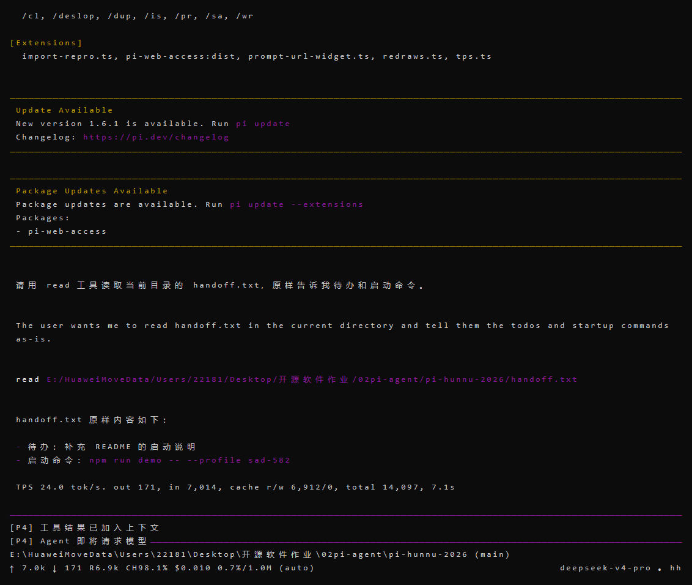
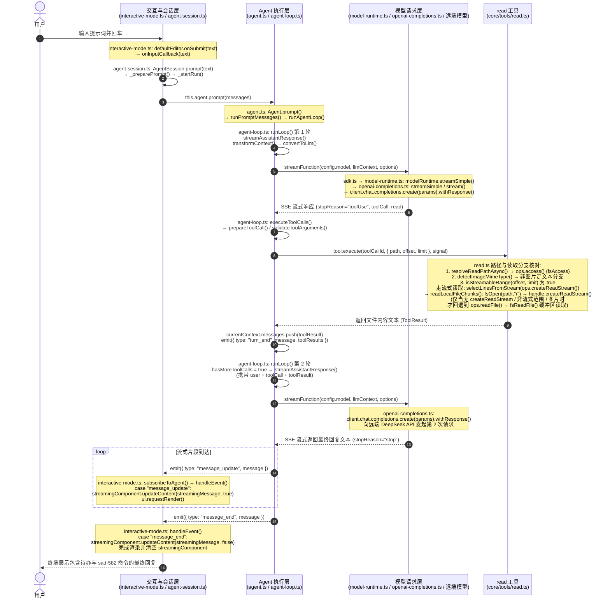
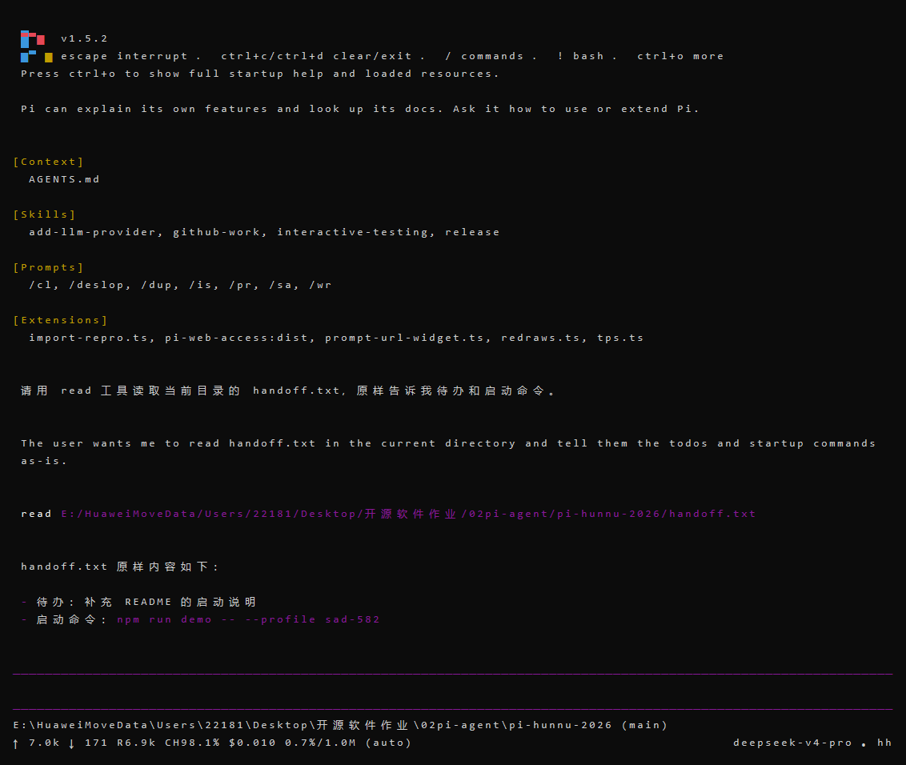
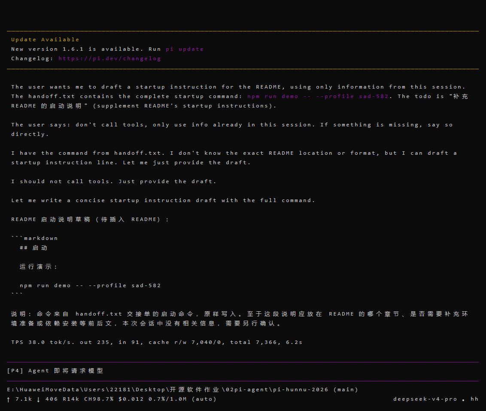
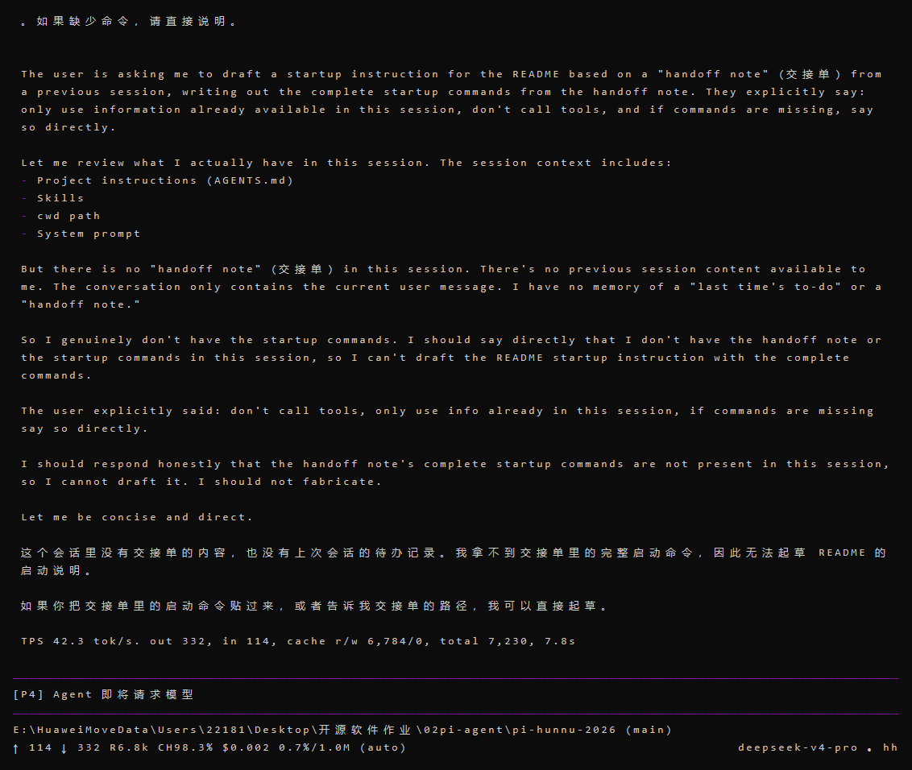
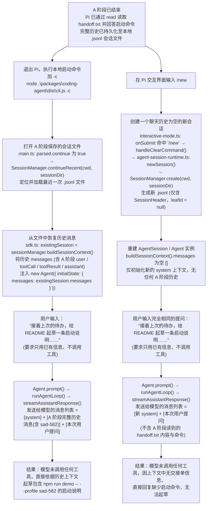

# 实践 05｜Pi Agent 源码泛读与功能定位

- **实验环境**：本地源码构建的 Pi Agent `v1.5.2`（仓库 `SAD-OpenStudy/pi-hunnu-2026`，入口 `node .\packages\coding-agent\dist\cli.js`）
- **使用模型**：`deepseek/deepseek-v4-pro`（接口协议 `openai-completions`）
- **交接文件**：在项目根目录创建 `handoff.txt`，使用本组随机标识 `sad-582`：
  ```text
  待办：补充 README 的启动说明
  启动命令：npm run demo -- --profile sad-582
  ```

---

## A. 单轮交互与工具调用

### 1. 实测现象记录

在 `pi-hunnu-2026` 目录启动本地构建的 Pi（`node .\packages\coding-agent\dist\cli.js`），在新会话输入：

> 请用 read 工具读取当前目录的 handoff.txt，原样告诉我待办和启动命令。

实测观察（会话文件 `01a216a2-1d91-742e-abf0-76b70e30f4c9.jsonl`）：
- **模型调用次数**：共 **2 次**模型请求（由实践 04 在 `agent-loop.ts` 埋点的 `[P4] Agent 即将请求模型` 与会话日志共同印证）。
  - 第 1 次模型响应返回 `stopReason: "toolUse"`，发出 1 次工具调用：`read({ path: "E:/.../pi-hunnu-2026/handoff.txt", offset: null, limit: null })`。
  - 本地执行 `read` 工具并将结果作为 `toolResult` 写入上下文（触发 `[P4] 工具结果已加入上下文`）。
  - 第 2 次模型请求携带了历史消息、`toolCall` 与 `toolResult`，返回 `stopReason: "stop"` 的最终回复。
- **Pi 最终回复**：
  ```text
  handoff.txt 原样内容如下：

  - 待办：补充 README 的启动说明
  - 启动命令：npm run demo -- --profile sad-582
  ```



### 2. 图 1：单轮工具调用的代码级时序图



### 3. 源码关键边界核对说明

- **输入与调度入口**：`packages/coding-agent/src/modes/interactive/interactive-mode.ts` 中的 `this.defaultEditor.onSubmit` 先过滤 `/` 斜杠命令，普通文本通过 `onInputCallback(text)` 交给 `AgentSession.prompt()`（`packages/coding-agent/src/core/agent-session.ts`），经 `_preparePrompt()` 和 `_startRun()` 后调用 `this.agent.prompt(messages)`。
- **Agent 主循环**：`packages/agent/src/agent.ts` 的 `Agent.prompt()` 将输入规范化后调用 `runPromptMessages()` → `runAgentLoop()`（`packages/agent/src/agent-loop.ts`）。每一轮循环内先调用 `streamAssistantResponse()` 请求模型，若返回包含 `toolCall`，则调用 `executeToolCalls()` 执行工具、把 `toolResult` 压入 `currentContext.messages`，随后再次进入 `streamAssistantResponse()` 发起第 2 次模型请求。
- **`read` 工具文件系统读取方式核对（流式 vs 缓冲区）**：
  - 在 `packages/coding-agent/src/core/tools/read.ts` 中，`defaultReadOperations` 默认同时提供了 `createReadStream: readLocalFileChunks` 与 `readFile: fsReadFile`。
  - 对于文本文件（如 `handoff.txt`），源码在读取分支判断 `ops.createReadStream && isStreamableRange(offset, limit)`：当未传 `offset`/`limit`（经参数校验后为 `undefined`）或为非负整数范围时，**实际走的是流式读取**，调用 `selectLinesFromStream(ops.createReadStream(absolutePath, { signal }), ...)`，底层在 `readLocalFileChunks()` 中通过 `fsOpen(path, "r")` 与 `handle.createReadStream({ end, autoClose: false })` 分块读取，避免整文件一次性加载进内存。
  - 只有在图片文件（`mimeType` 命中）、自定义 `operations` 未提供 `createReadStream`、或传入非流式范围（如小数、负数 `limit`）时，才会走 `ops.readFile(absolutePath)`（`fsReadFile`）+ `selectLinesFromBuffer()` 的整文件缓冲区读取。
- **回复显示位置**：`interactive-mode.ts` 通过 `subscribeToAgent()` 订阅 `this.session.subscribe(event => this.handleEvent(event))`。在 `handleEvent()` 中，`case "message_update"` 持续调用 `this.streamingComponent.updateContent(this.streamingMessage, true)` 与 `this.ui.requestRender()` 将流式文本实时渲染到终端；`case "message_end"` 调用 `this.streamingComponent.updateContent(this.streamingMessage, false)` 完成最终定稿显示。

---

## B. 恢复上次会话，继续写 README

### 1. 两次实测对比记录

完成阶段 A 后输入 `/quit` 退出 Pi，随后在同一项目目录、使用同一模型 `deepseek-v4-pro`，分别在两种会话模式下输入完全相同的提问：

> 接着上次的待办，给 README 起草一条启动说明，写出交接单里的完整启动命令。只用这次会话已有的信息。不要调用工具。如果缺少命令，请直接说明。

| 对比维度 | 情况 1：恢复旧会话（`-c`） | 情况 2：新建会话（`/new`） |
| --- | --- | --- |
| 启动/切换方式 | `node .\packages\coding-agent\dist\cli.js -c` | 在交互界面输入 `/new` |
| 终端是否可见 A 阶段记录 | 是（启动后直接渲染出 A 阶段的提问、`read` 调用及回复） | 否（开启空会话，显示 `✓ New session started`） |
| 对应的会话文件 | 沿用原文件 `01a216a2-1d91-742e-abf0-76b70e30f4c9.jsonl`（新消息 `parentId` 指向 A 阶段最后一条回复 `75be51a5`） | 新建文件 `01a216a2-9e21-7552-8d2d-cc4a18f2a21c.jsonl`（新消息 `parentId` 仅指向新 `system` 消息 `eec51b57`） |
| 是否调用工具 | **否**（0 次工具调用，仅 1 次模型请求） | **否**（0 次工具调用，仅 1 次模型请求） |
| 模型实际回答摘要 | 成功起草 README 启动说明，并准确写出完整启动命令 `npm run demo -- --profile sad-582` | 明确说明“这个会话里没有交接单的内容，也没有上次会话的待办记录。我拿不到交接单里的完整启动命令，因此无法起草 README 的启动说明。” |

#### 情况 1（`-c` 恢复旧会话）真实终端截图

1. 执行 `node .\packages\coding-agent\dist\cli.js -c` 启动后，终端立即恢复并显示阶段 A 的聊天记录：



2. 发送相同提问后，Pi 未调用任何工具（仅触发 1 次 `[P4] Agent 即将请求模型`），直接基于恢复的历史上下文写出包含 `npm run demo -- --profile sad-582` 的 README 启动说明草稿：



#### 情况 2（`/new` 新建会话）真实终端截图

输入 `/new` 开启新会话并发送完全相同的提问后，Pi 同样未调用任何工具（仅 1 次模型请求），并如实回复缺少交接单和启动命令：



### 2. 图 2：恢复旧会话和新建会话的对照图



### 3. 源码定位与修改点总结

通过本次“真实操作 → 会话文件 → 源码调用链”的双向定位，可以明确各核心功能在源码中的入口与适合扩展修改的位置：
1. **交互输入与斜杠命令拦截**：`packages/coding-agent/src/modes/interactive/interactive-mode.ts` 的 `defaultEditor.onSubmit`（新增自定义命令或拦截输入）。
2. **会话持久化、恢复与切换**：`packages/coding-agent/src/main.ts`（`-c` 解析）、`packages/coding-agent/src/core/session-manager.ts`（`continueRecent` / `create` / `buildSessionContext`）与 `packages/coding-agent/src/core/agent-session-runtime.ts`（`newSession`）。
3. **上下文拼装与多轮工具循环**：`packages/agent/src/agent-loop.ts` 的 `runLoop`、`streamAssistantResponse` 与 `executeToolCalls`（适合增加调用观测日志、工具策略拦截或上下文裁剪）。
4. **本地文件读取工具实现**：`packages/coding-agent/src/core/tools/read.ts` 的 `createReadTool` / `readLocalFileChunks` / `isStreamableRange`（适合调整截断阈值或读取安全边界）。
