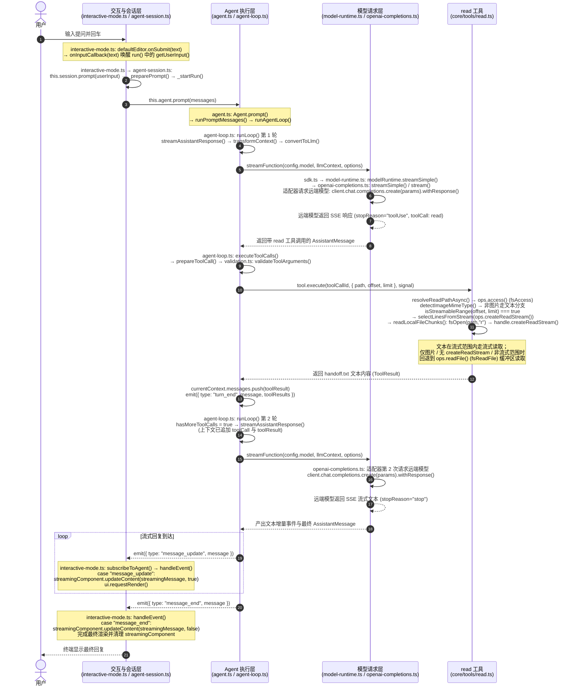
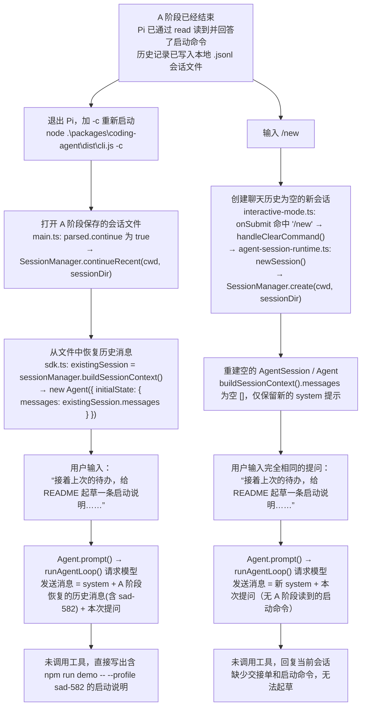

# 实践课 5：Pi Agent 源码泛读与功能定位

本次实验在小组源码仓库 `pi-hunnu-2026` 根目录进行，使用本地编译的 Pi（`v1.5.2`，`node .\packages\coding-agent\dist\cli.js`）和 `deepseek-v4-pro` 模型。

## A. 单轮交互与工具调用

我在项目根目录创建了 `handoff.txt`，把示例标识替换成随机生成的 `sad-582`：

```text
待办：补充 README 的启动说明
启动命令：npm run demo -- --profile sad-582
```

启动本地构建的 Pi 后，在新会话输入：

> 请用 read 工具读取当前目录的 handoff.txt，原样告诉我待办和启动命令。

这一轮交互实际发生了 **2 次模型请求**和 **1 次 `read` 工具调用**：第 1 次模型请求返回 `toolUse`，调用 `read` 读取 `handoff.txt`；工具结果写入上下文后发起第 2 次模型请求，Pi 给出最终回复：

> handoff.txt 原样内容如下：
> - 待办：补充 README 的启动说明
> - 启动命令：npm run demo -- --profile sad-582

### 图 1：单轮工具调用的代码级时序图



核对源码时的关键点：
- `read.ts` 的 `defaultReadOperations` 同时提供 `createReadStream`（`readLocalFileChunks`）和 `readFile`（`fsReadFile`）。这次调用虽然模型输出了 `offset: null, limit: null`，但在执行前经 `packages/ai/src/utils/validation.ts` 的 `validateToolArguments()` 清洗为省略（`undefined`），因此 `isStreamableRange(offset, limit)` 返回 `true`，**实际走的是流式读取**（`fsOpen` + `handle.createReadStream` + `selectLinesFromStream`）。只有读取图片、未提供 `createReadStream` 或传入非流式范围时，才会走 `fsReadFile` 整文件缓冲区读取。
- 界面输出在 `interactive-mode.ts` 的 `subscribeToAgent()` 订阅 `this.session.subscribe(...)`，进入 `handleEvent()` 的 `message_update`（流式刷新）和 `message_end`（定稿显示）分支。

---

## B. 恢复上次会话，继续写 README

A 阶段完成后退出 Pi，在同一项目目录、用同一个模型 `deepseek-v4-pro`，分别在“恢复旧会话”和“新建会话”两种情况下输入完全相同的话：

> 接着上次的待办，给 README 起草一条启动说明，写出交接单里的完整启动命令。只用这次会话已有的信息。不要调用工具。如果缺少命令，请直接说明。

### 1. 两次实测记录

1. **恢复原会话（`node .\packages\coding-agent\dist\cli.js -c`）**
   - 启动后终端里可以直接看到 A 阶段的对话和 `read` 记录，继续沿用同一个 `.jsonl` 会话文件。
   - **是否调用工具**：否（0 次工具调用，仅 1 次模型请求）。
   - **实际回答**：直接起草了 README 启动说明，并准确写出了完整启动命令 `npm run demo -- --profile sad-582`。

2. **新建会话（输入 `/new`）**
   - 界面提示 `✓ New session started`，创建了新的空 `.jsonl` 会话文件。
   - **是否调用工具**：否（0 次工具调用，仅 1 次模型请求）。
   - **实际回答**：
     > 这个会话里没有交接单的内容，也没有上次会话的待办记录。我拿不到交接单里的完整启动命令，因此无法起草 README 的启动说明。
     > 如果你把交接单里的启动命令贴过来，或者告诉我交接单的路径，我可以直接起草。

### 2. 图 2：恢复旧会话和新建会话的对照图


