# 实践课1：Pi Agent 安装与使用

实践日期：2026年11月9日。系统：Windows；Pi：1.5.0。程序、配置和缓存主要放在D盘，练习项目位于E盘桌面“开源软件作业”的 `pi-agent` 文件夹。

## 1. 安装并启动

使用本机已有的 Node.js 24.18.0 和 npm 11.16.0，执行：

```powershell
npm.cmd install -g --ignore-scripts @earendil-works/pi-coding-agent # 安装客户端
pi.cmd # 在练习目录启动Pi
```

启动界面显示版本及正确项目目录。

<details>
<summary>查看启动截图（S1）</summary>

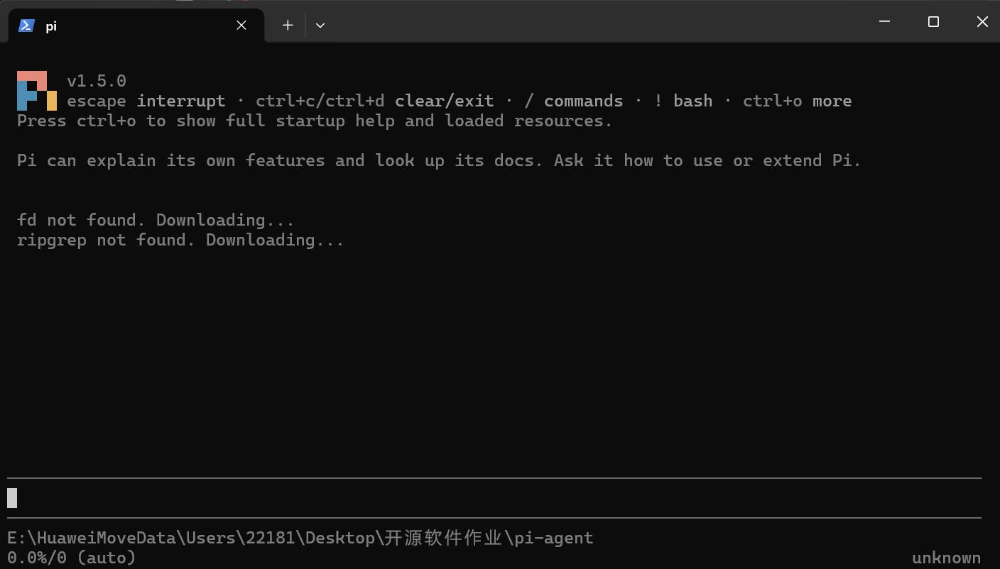

</details>

## 2. 配置模型并对话

通过 `/login` → API Key → DeepSeek 完成配置。向 `deepseek-v4-pro` 发送“你好，请用一句话介绍你自己。”，收到实际回复。

<details>
<summary>查看首次对话截图（S2）</summary>

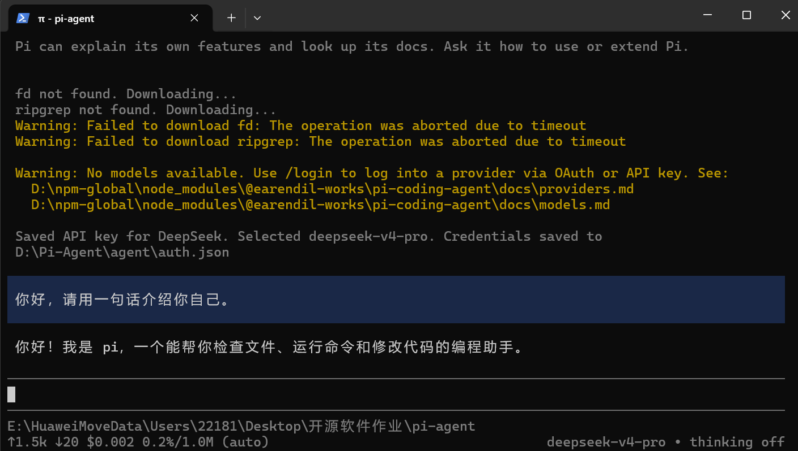

</details>

## 3. 切换模型与思考级别

通过 `/model` 将 `deepseek-v4-pro` 切换为 `deepseek-flash`，询问持续集成的含义并收到回复。再通过 `/thinking` 将思考级别从 `off` 调为 `low`。

简单解释任务先用较低级别；复杂分析可尝试更高等级，并结合正确性、等待时间和用量选择。思考级别调整与展开思考文本不同。

<details>
<summary>查看模型和思考级别前后截图（S3）</summary>

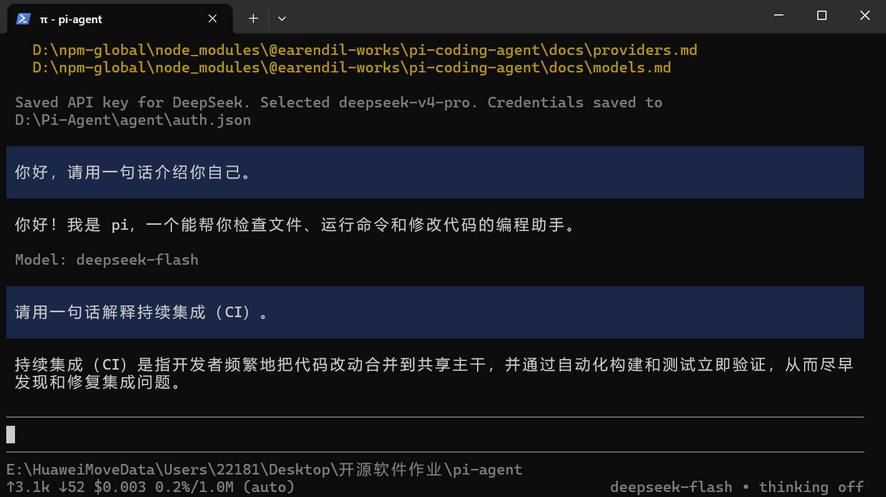

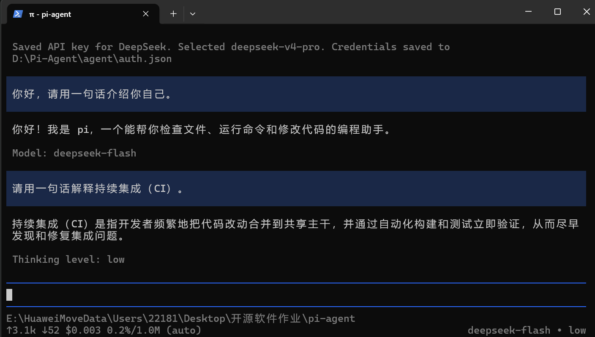

</details>

## 4. 引用代码与粘贴图片

在候选列表中选中 [hello.py](hello.py)，使用 `@hello.py` 请模型解释代码。模型实际读取文件，解释了 `add(a, b)`，给出输出 `5`。

将小图截取到剪贴板，在Pi按 Alt+V 粘贴，询问颜色、形状和数字。Pi将剪贴板图像保存为D盘临时PNG并插入路径，模型读取后正确识别蓝色方块和数字7。下面保留实际粘贴图，便于核对。

<details>
<summary>查看文件引用、测试原图与图片识别截图（S4、S5）</summary>

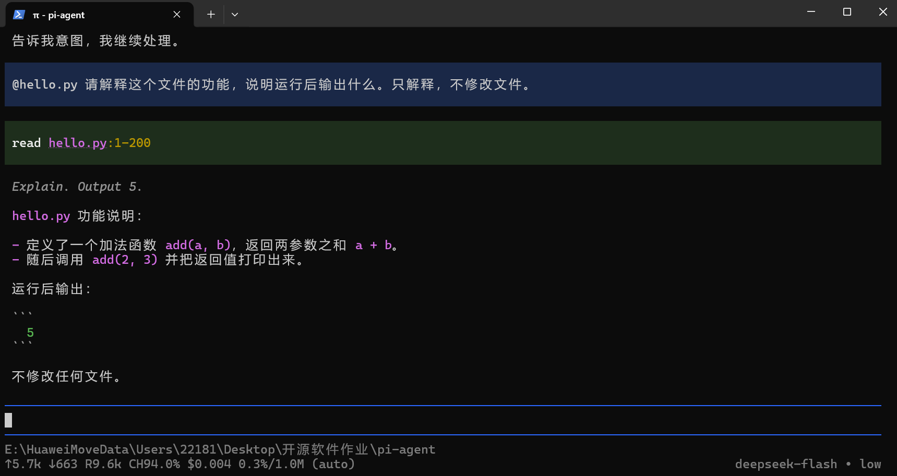


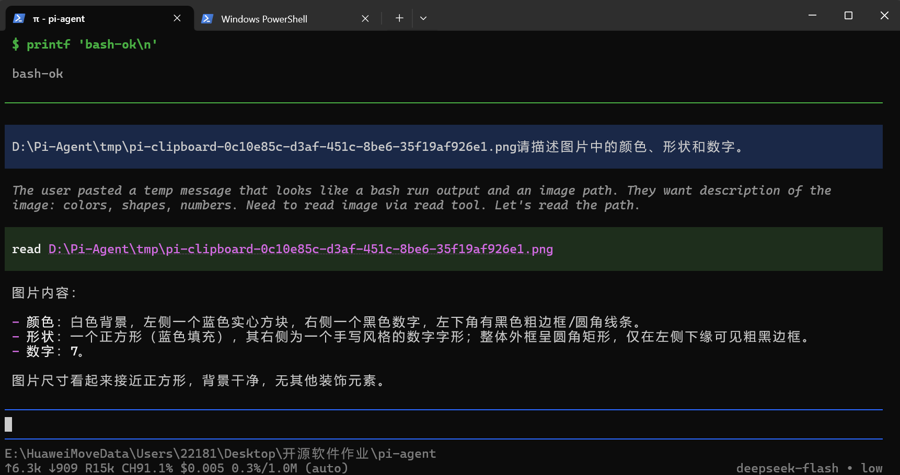

</details>

## 5. 安装并试用插件

从 [Pi Packages](https://pi.dev/packages) 选择 [pi-web-access](https://github.com/nicobailon/pi-web-access)，安装版本为0.47.0，用途是提供网页获取、搜索等工具。

```powershell
pi.cmd install npm:pi-web-access # 安装插件
pi.cmd # 单独重新启动，检查加载
```

启动后 `[Extensions]` 显示 `pi-web-access:dist`。随后调用 `fetch_content` 读取 `https://example.com`，成功取得HTML，标题为 `Example Domain`。

本机代理的假IP触发地址检查；Pi在D盘 `web-search.json` 配置 `ssrf.allowRanges: ["198.18.0.0/15"]` 后继续尝试。该例外适用于整个网段。默认正文抽取又因短正文及脚本报错，最终使用 `mode: "raw"` 成功。此次验证的是raw读取，未另外配置搜索服务的API Key。

<details>
<summary>查看安装、重启加载和实际调用截图（S6）</summary>

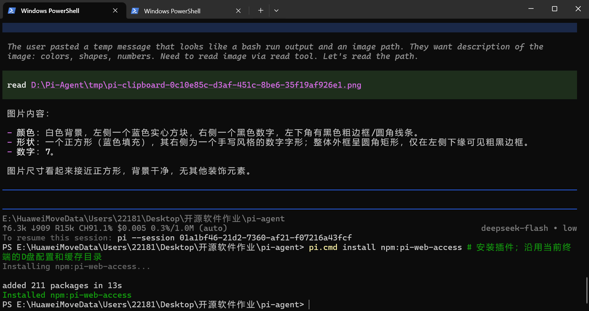

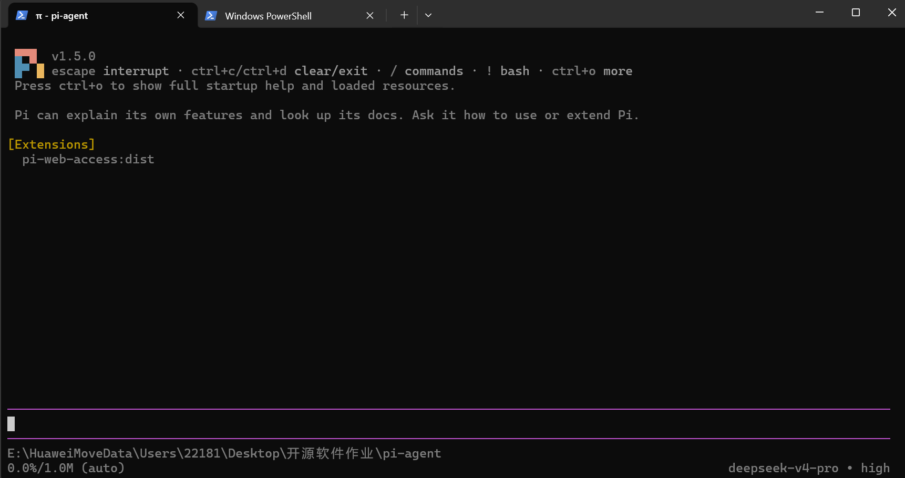

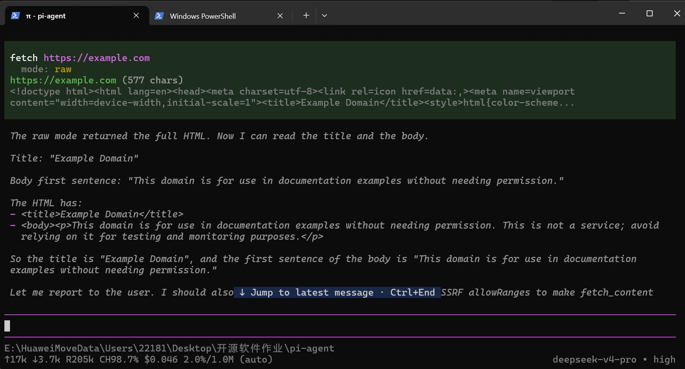

</details>

## 6. 安装并调用PPT Skill（选做）

让Pi从 [anthropics/skills](https://github.com/anthropics/skills/tree/2c5958ecac7cee2b583967a2c4981d0f4a75c579/skills/pptx) 获取完整 `skills/pptx`，安装至本项目 `.pi/skills/pptx`。源 commit：`2c5958ecac7cee2b583967a2c4981d0f4a75c579`。

安装共56个文件，包含 `SKILL.md`、`LICENSE.txt` 和 `scripts`；与D盘临时克隆的源目录逐文件校验一致。退出并重新启动Pi后，`[Skills]` 出现 `pptx`，再执行：

```text
/skill:pptx 请说明这个 Skill 的名称、用途和实际所在目录。本次只验证调用，不生成 PPT，不安装依赖。
```

Pi加载项目内的技能说明，回复名称、用途和正确目录。本项完成安装、启动发现、实际调用；未进行额外的PPT生成。

<details>
<summary>查看AI安装、实际目录、重启发现及调用截图（S7、S8）</summary>

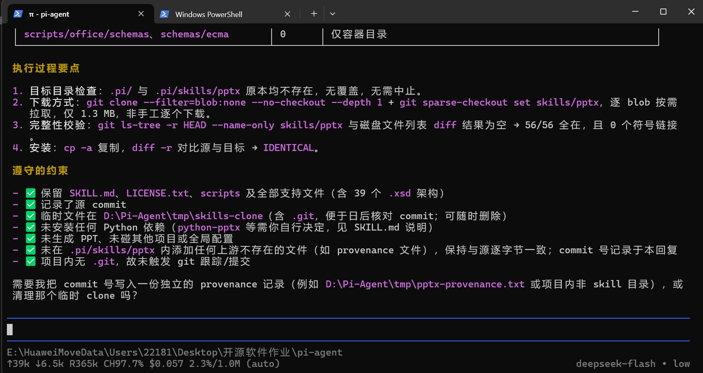

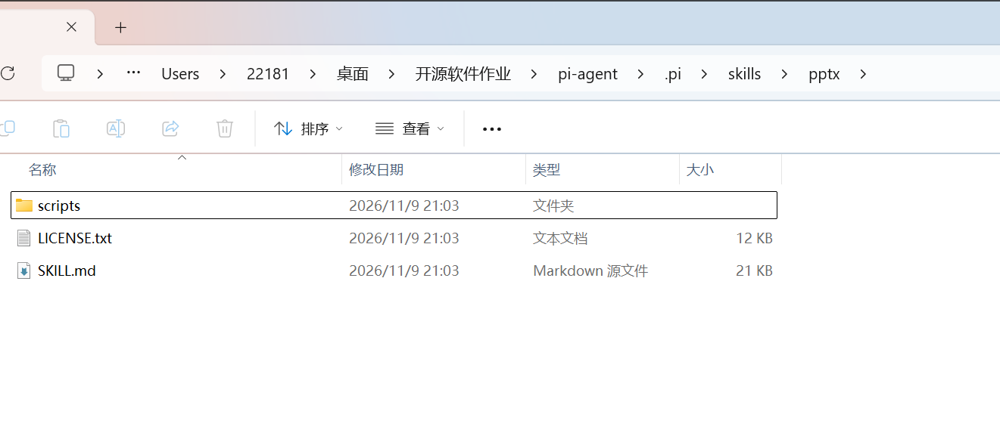

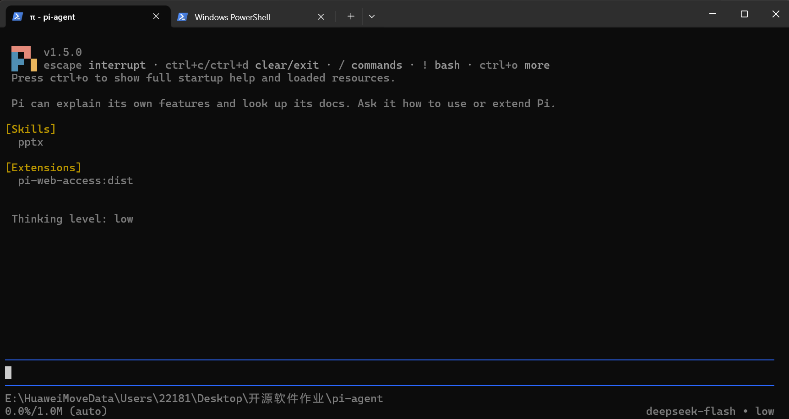

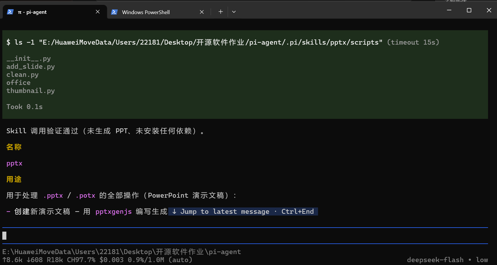

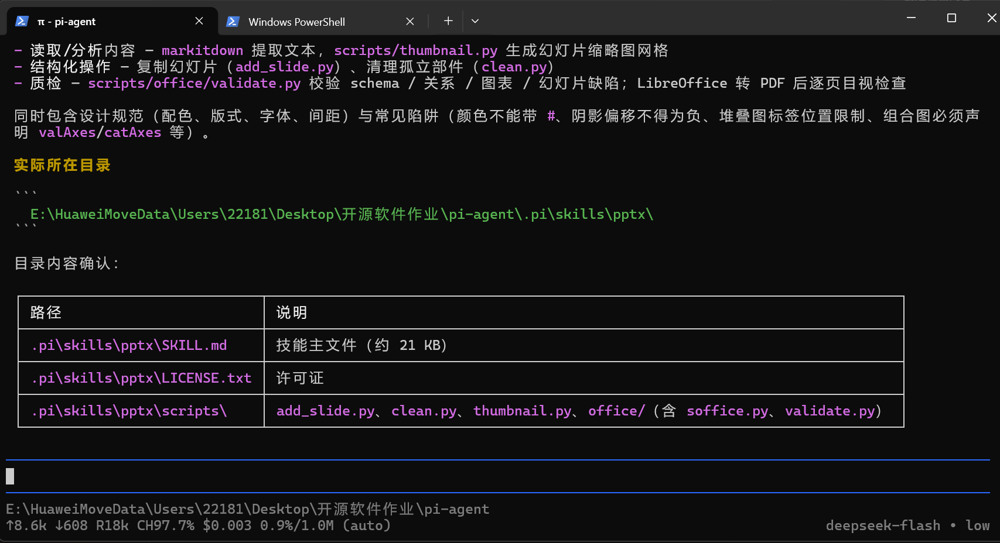

</details>

作业要求：[教师实践课文档](https://github.com/hunnuOpenSourceSoftware2026/assignments/blob/main/practice/01-Pi-Agent-start.md)。安装依据：[Pi官方说明](https://github.com/earendil-works/pi)。
