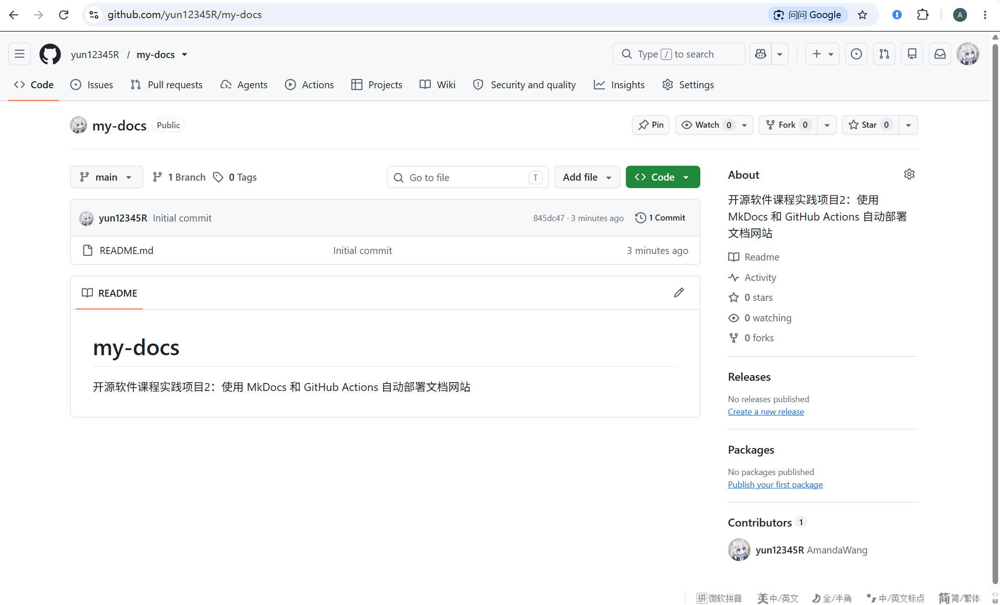
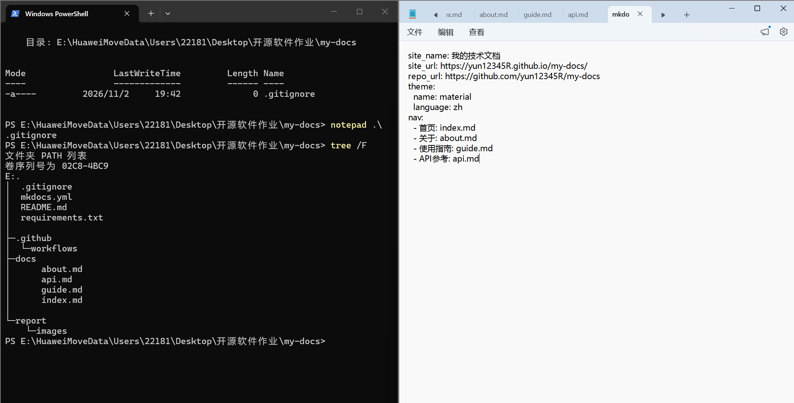
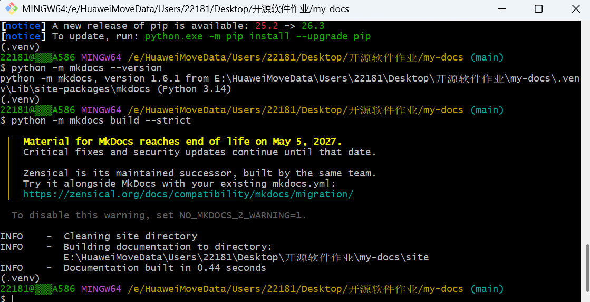
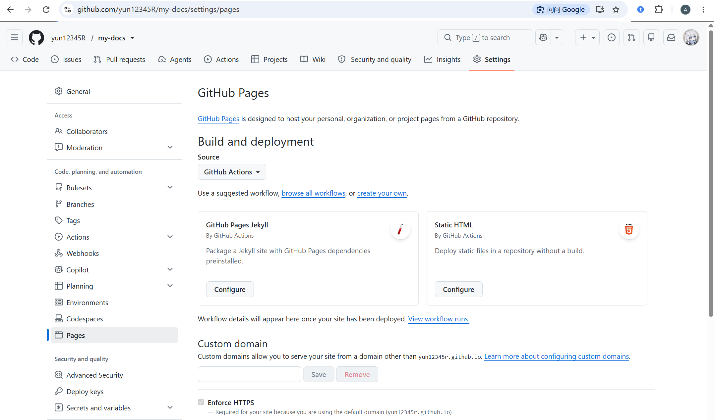
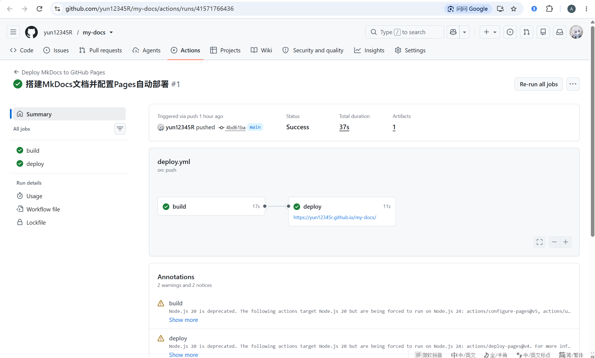
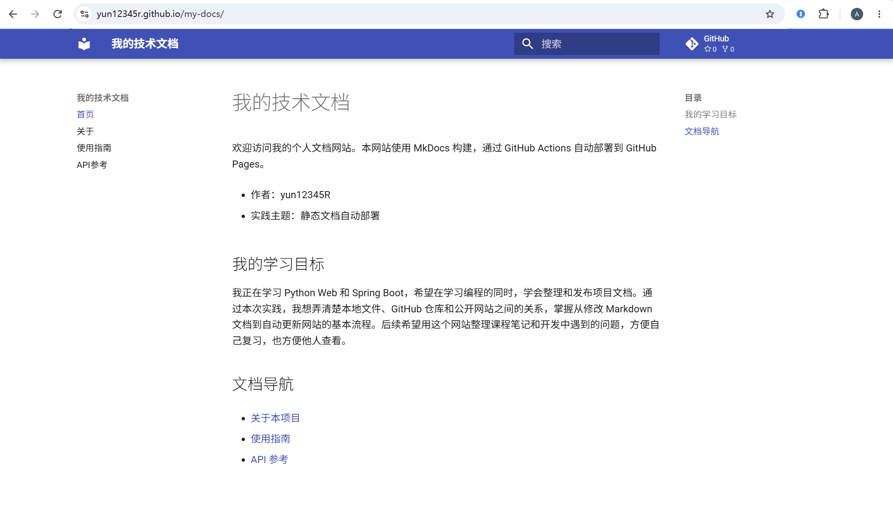
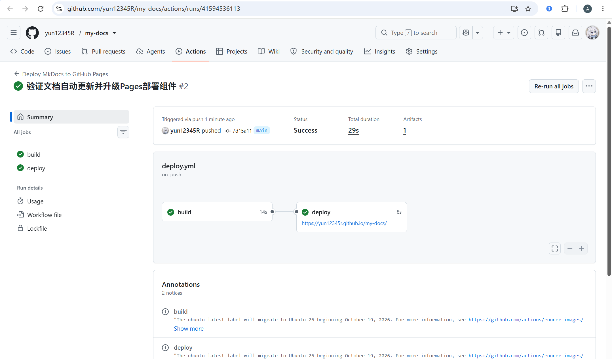
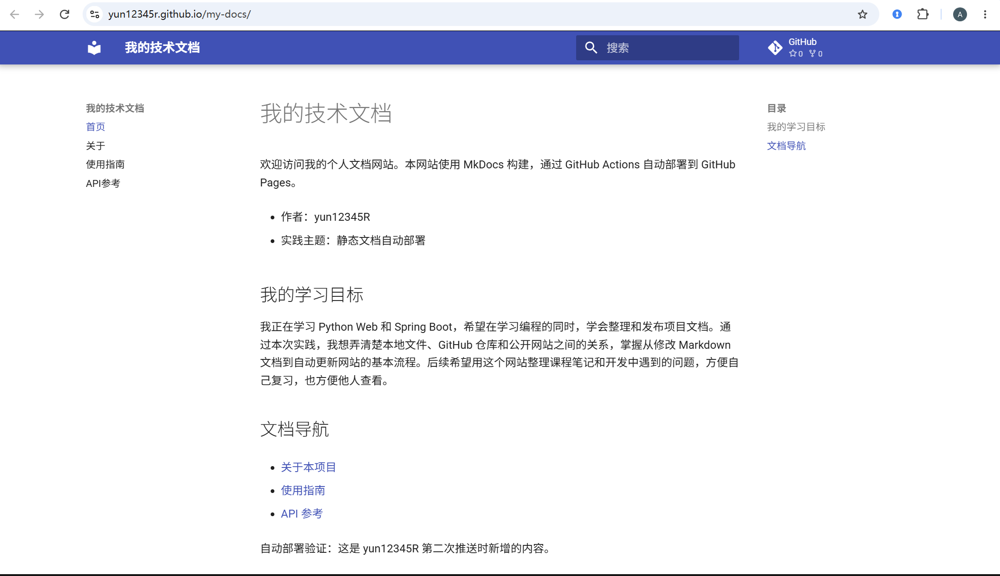

# 实践项目2：个人实验报告

## 1. 基本信息

- GitHub 登录名：yun12345R
- 个人仓库地址：https://github.com/yun12345R/my-docs
- 最终网站地址：https://yun12345r.github.io/my-docs/

## 2. 实践过程与关键截图

### 2.1 仓库创建

我使用自己的 GitHub 账号创建了公开仓库 my-docs，并初始化 README 文件。公开仓库便于老师查看项目源码、工作流和实验报告。

创建完成后，我使用 git clone 将仓库克隆到电脑上的“开源软件作业”文件夹中，确认当前分支为 main，随后在本地编写文档和配置文件。

### 2.2 项目结构与 MkDocs 配置

我在 docs/ 目录中创建了首页、关于、使用指南和 API 参考四个 Markdown 文件，并在项目根目录的 mkdocs.yml 中设置网站名称、公开网址、Material 主题和中文界面。

各部分的作用如下：

- docs/：保存我编写的网站内容，是网站的源文件。
- nav：配置导航名称、顺序及对应页面。路径相对于 docs/，所以首页写为 index.md。
- site/：执行构建命令后自动生成的网站文件。它可以由源文件重新生成，因此不需要手工修改，也不提交到 main 分支。

我在 .gitignore 中忽略了 site/ 和 .venv/，避免把生成的网站和本地虚拟环境加入源码提交。

### 2.3 本地构建与预览

我的本机 Python 版本为 3.14.0。我创建了 .venv 虚拟环境，在 Git Bash 中激活，并按照 requirements.txt 安装依赖，实际安装的 MkDocs 版本为 1.6.1，Material 主题版本为 9.8.0。

我执行 `python -m mkdocs build --strict` 检查文档，终端显示 Documentation built in ... seconds，说明本地构建成功。

随后执行 `python -m mkdocs serve`，在浏览器打开 http://127.0.0.1:8000/my-docs/ 进行预览。我逐一检查了首页、关于、使用指南和 API 参考，确认导航及页面间链接可用，表格和 JSON 代码块显示正常。检查完成后，按 Ctrl+C 停止本地预览。

### 2.4 Pages 设置

我进入个人仓库的 Settings → Pages，在 Build and deployment 中将 Source 设置为 GitHub Actions，使网站通过工作流构建和发布。

随后进入 Settings → Actions → General，确认仓库允许使用部署工作流所需的 Actions，保证后续构建和部署任务能够运行。

### 2.5 Actions 首次构建和部署

我提交文档和部署配置后，将提交 4bd61ba 推送到 main 分支，自动触发了部署工作流。

build 任务使用 Python 3.12 安装依赖，执行严格构建，并上传生成的 site/ 目录。deploy 任务通过 needs: build 等待构建成功，再将网站发布到 GitHub Pages。

部署任务配置了 pages: write 和 id-token: write 权限，并使用 github-pages 环境记录部署结果。

首次运行的 build 和 deploy 均成功，整体状态为 Success。页面同时出现了两条 Node.js 20 弃用提醒，我在后续第二次推送中升级了相关组件并重新验证。

[首次成功的 Actions 运行记录](https://github.com/yun12345R/my-docs/actions/runs/41571766436)

### 2.6 网站访问与四页导航检查

首次部署成功后，我在浏览器访问公开网站：https://yun12345r.github.io/my-docs/。

我逐一打开了首页、关于、使用指南和 API 参考，检查页面内容、导航及页面间链接。首页介绍正常显示，关于页的表格、使用指南中的命令和 API 页的 JSON 代码块均能正常展示。

下面的截图保留了浏览器地址栏，记录网站通过 GitHub Pages 公开访问的效果。

### 2.7 第二次推送与自动更新验证

我在首页末尾新增了下面这句话，用于辨认网站是否更新：

> 自动部署验证：这是 yun12345R 第二次推送时新增的内容。

同一次提交中，我还升级了三个 Pages 部署组件，处理首次运行出现的 Node.js 20 弃用提醒。

完成本地严格构建检查后，我提交修改并执行 git push origin main。第二次运行记录显示触发方式为 push，build 和 deploy 均成功，之前的两条 Node.js 20 提醒不再出现。

刷新公开网站后，首页显示了新增文字，验证了“修改文档 → 推送提交 → 自动构建和部署 → 网站更新”的完整过程。

- [对应提交：7d15a11](https://github.com/yun12345R/my-docs/commit/7d15a110a8b0edb22ba20ad98e880a3e6d4e0cc5)
- [第二次自动部署成功的运行记录](https://github.com/yun12345R/my-docs/actions/runs/41594536113)

## 3. 问题与解决

### 3.1 PowerShell 无法激活虚拟环境

执行 Activate.ps1 时，PowerShell 提示系统禁止运行脚本。这是脚本执行策略的限制。

我按照作业说明切换到 Git Bash，执行 `source .venv/Scripts/activate`，成功激活虚拟环境，没有修改系统执行策略。

### 3.2 记事本中的 Markdown 格式问题

编辑文档时，记事本的格式化模式导致部分标题和列表符号前出现多余的反斜杠，表格中也出现了空行。

我切换到“查看 → Markdown → 语法”，清理多余的转义符，修正表格和代码块，并通过本地预览确认显示正常。

### 3.3 首次部署出现 Node.js 20 提醒

首次 Actions 运行虽然成功，但出现了两条 Node.js 20 弃用提醒。检查日志后，发现提醒来自部署组件使用的运行环境。

我将 actions/configure-pages 从 v5 升级到 v6，将 actions/upload-pages-artifact 和 actions/deploy-pages 从 v4 升级到 v5，然后随首页修改一起提交并推送。

第二次运行的 build 和 deploy 均成功，原来的两条 Node.js 20 提醒消失。页面剩余的两条 notices 是 Ubuntu 运行环境通知，本次部署正常完成。

## 4. 原理理解

### 4.1 docs/ 和 site/ 各保存什么？为什么不用手工修改 site/？

docs/ 保存我编写的 Markdown 源文件；site/ 保存 MkDocs 构建生成的 HTML、样式和其他网站资源。

修改内容时应该编辑 docs/，再重新构建。直接修改 site/ 的内容会在下次构建时被覆盖。

### 4.2 本次工作流在什么情况下自动运行？

当提交推送到 main 分支，并且改动涉及 docs/、mkdocs.yml、requirements.txt 或 .github/workflows/deploy.yml 时，工作流会自动运行。

workflow_dispatch 则提供手动运行入口，方便重试和排查问题。

### 4.3 build 与 deploy 两个任务有什么区别？

build 负责取出源码、安装依赖、构建网站，并上传 site/ 构建产物，相当于把文档制作成网站文件。

deploy 负责将构建产物发布到 GitHub Pages，让访问者通过公开网址查看。needs: build 表示只有 build 成功，deploy 才能执行。

### 4.4 只修改报告会触发部署吗？为什么？

只修改 report/README.md 不会自动触发本次部署，因为它没有命中工作流 push 配置中的 paths 范围。

报告用于记录实验过程，不属于 docs/ 中的网站内容，因此更新报告不需要重新发布网站。

### 4.5 本次方案为何无需创建 gh-pages 分支？

本方案通过官方 Pages Actions 上传和部署 site/ 构建产物，Pages 发布来源也设置为 GitHub Actions。

网站文件通过构建产物交给部署任务，不需要另外保存到 gh-pages 分支，因此无需创建该分支。